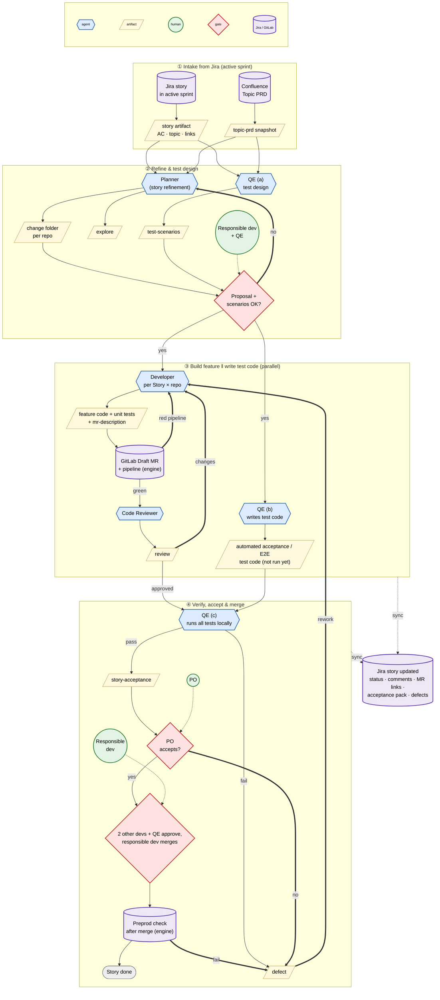
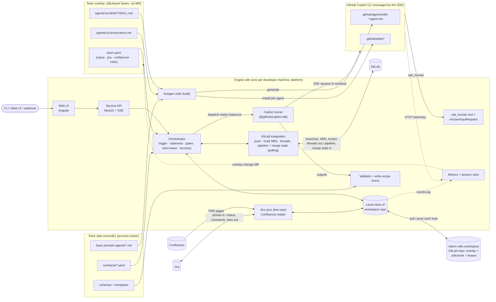
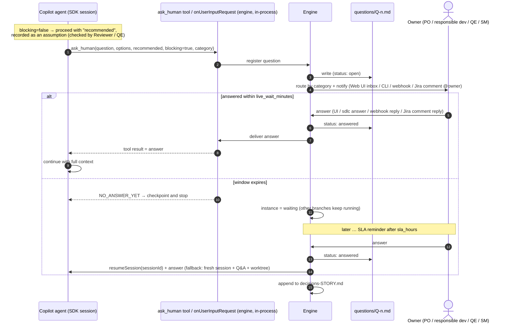
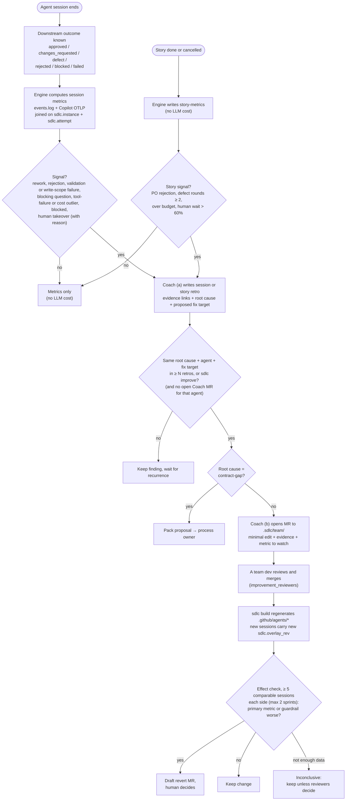
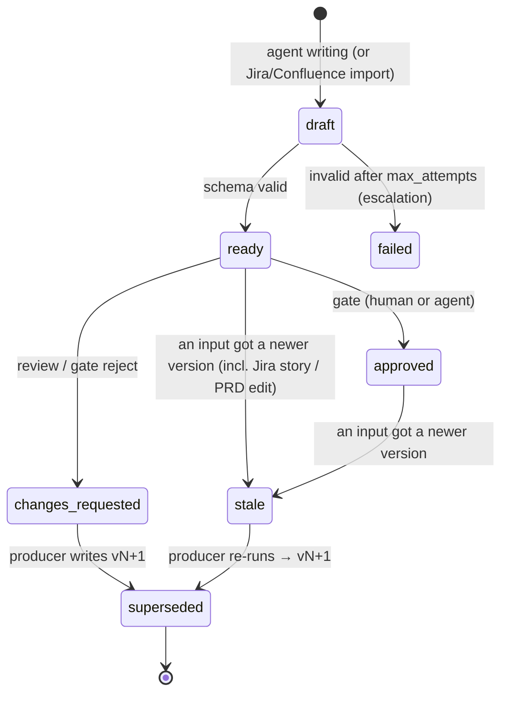
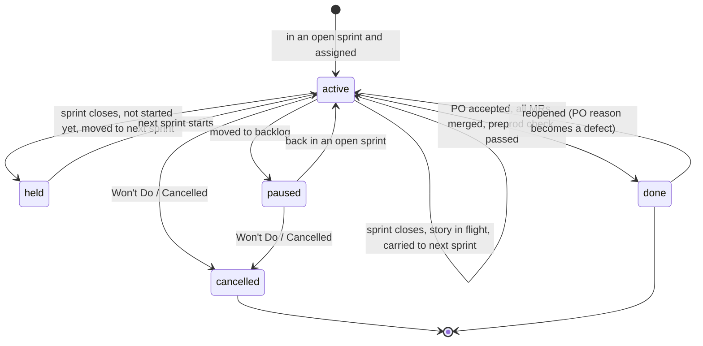

# Reusable Artifact-Driven Agentic Workflow on GitHub Copilot — Phase 1 Plan

**Phase 1 plan · SAFe Scrum team · GitHub Copilot**

Contract-driven agents that start when their input artifacts are ready, triggered by Jira stories in the active sprint, with per-session retrospectives that improve each team's overlay.

`5 agents` · `Jira ⇄ two-way` · `Confluence PRD` · `Copilot SDK` · `NestJS + Angular` · `GitLab MRs` · **Status: approved (2026-11-23)**

> Exported on 2026-11-21 from the artifact https://claude.ai/artifact/83GxALqBhdCwSoNymSY2Bi (version `1795250480-83d2`). This repo copy is now the source of truth.
>
> **Applied since export (2026-11-21):** G1 (GitLab merge requests; the engine opens the MRs), G2 (`ask_human` is an in-process tool, not MCP), G3 (engine per developer machine, story owned by its Jira assignee, shared workspace repo, restart recovery), G4 (story lifecycle and sprint boundaries), G5 (human takeover and handback), G6 (AI-credit budget on each dev's own Copilot seat), G7 (untrusted input and agent isolation), G8 (Phase 1 success criteria), G9 (open questions checklist), G10 (effect check and Coach MR limits), G11 (execution model stated explicitly), G12 (per-story metrics and story retros). All review gaps G1–G12 are applied. Open review proposals are in [review-notes.md](review-notes.md).

## Sections

- [Context](#context)
- [0. Diagrams (Mermaid)](#0-diagrams-mermaid)
- [1. Three layers](#1-three-layers)
- [2. Engine mechanics](#2-engine-mechanics)
- [3. Jira & Confluence integration (two-way)](#3-jira--confluence-integration-two-way)
- [3a. GitLab: merge requests, review and merge](#3a-gitlab-merge-requests-review-and-merge)
- [3b. Story lifecycle and sprint boundaries](#3b-story-lifecycle-and-sprint-boundaries)
- [4. Agents — pack safe-scrum (Phase 1, 5 agents)](#4-agents--pack-safe-scrum-phase-1-5-agents)
- [4a. QE in detail: define → write → run (ATDD)](#4a-qe-in-detail-define--write--run-atdd)
- [5. GitHub Copilot runtime](#5-github-copilot-runtime)
- [5a. Cost and AI credits](#5a-cost-and-ai-credits)
- [5b. Security: untrusted input and agent isolation](#5b-security-untrusted-input-and-agent-isolation)
- [6. Asking humans: live wait first, durable fallback](#6-asking-humans-live-wait-first-durable-fallback)
- [6a. Human takeover and handback](#6a-human-takeover-and-handback)
- [7. Session retrospective (workflow self-improvement)](#7-session-retrospective-workflow-self-improvement)
- [8. CLI + Web UI on one service](#8-cli--web-ui-on-one-service)
- [9. Layout](#9-layout)
- [10. Build order](#10-build-order)
- [11. Verification](#11-verification)
- [12. Success criteria](#12-success-criteria)
- [13. Open questions](#13-open-questions)
- [Later phases](#later-phases)

## Context

A SAFe Scrum team wants an agentic SDLC workflow where **each agent has a contract** (typed input artifacts → typed output artifacts) and **starts as soon as its inputs are ready**. It must be **reusable**: any team plugs in only its own instructions, skills and conventions per agent, and never rebuilds the workflow.

**The team's real process (the workflow's starting point):** at PI Planning, each planned **Topic** has a PRD on **Confluence**, and the team creates the **user stories in Jira** from it. The workflow therefore starts from **Jira user stories in the active sprint**. It does not write PRDs or break features into stories.

**Phase 1 scope (confirmed):**

- **GitHub Copilot only** (driven through the official **Copilot SDK** `@github/copilot-sdk`, plus custom agents and Agent Skills)
- **Tech stack: TypeScript end to end.** The engine, CLI and service are Node.js with NestJS, the Web UI is Angular, and both live in an Nx monorepo. This matches the team's Angular skills, and the NestJS style (DI and decorators) is familiar to both Angular and Quarkus developers. Copilot's own SDKs, ACP, MCP and OpenTelemetry are all first-class in TypeScript. Copilot CLI is npm-distributed, so Node is already on every dev machine.
- multi-repo, hosted on **GitLab** (merge requests opened by the engine, see §3a)
- **engine runs on each developer's machine** in Phase 1; each story is driven by its Jira assignee's engine (§2). A shared team host comes later.
- **two-way Jira sync**
- Confluence PRD read-only
- **active Jira sprint = committed** (no separate commit step)
- CLI + Web UI
- humans can answer agents live
- a **retrospective after each agent session** for self-improvement

**Deferred:** Claude Code runtime, a PRD-writing agent, PI-level breakdown, iteration and PI reports, SAFe I&A.

Reuse: the user's `wf-plan` and `team-apply` skills (`~/.claude/skills/synced/…`) become the first **team overlay** (Planner and Developer). Their change-folder paths conflict (`specs/changes/` vs `.team/changes/`); the overlay standardizes on `.team/changes/`.

## 0. Diagrams (Mermaid)

To view them in VS Code, install **Markdown Preview Mermaid Support** (`bierner.markdown-mermaid`) and press Cmd+Shift+V. They also render on GitHub/GitLab and at mermaid.live. During implementation they will be saved under `docs/diagrams/` in the engine repo.

### 0.1 Artifact flow: who produces what, and what triggers whom

**Legend:**

- ⬡ blue = agent
- ▱ yellow = artifact
- ◯ green = human
- ◇ red = human gate
- ▭ purple = Jira / Confluence / GitLab
- solid → flow
- thick ⇒ rework
- dotted ┄ human action or Jira sync

The flow reads top to bottom. An agent fires as soon as all of its incoming artifacts are ready.



### 0.2 Three layers + integrations: teams only edit the overlay



### 0.3 Agent asks a human: live wait first, durable fallback



### 0.4 Session retrospective → workflow self-improvement



### 0.5 Artifact lifecycle



## 1. Three layers

| Layer | Contents | Edited by |
| --- | --- | --- |
| **Engine** (TypeScript: npm package `@<org>/sdlc` with the CLI, NestJS service and Angular UI) | orchestrator, artifact store, trigger rule, staleness, gates, locks, validation, write-scope check, **Jira two-way sync + Confluence reader**, **GitLab MR integration**, Copilot runner (Copilot SDK), host-file generator, API + Web UI, `ask_human` tool, telemetry ingest, session retro | platform maintainers |
| **Pack** `safe-scrum@1` | agent roster, contracts, artifact schemas/templates, base prompts (team-neutral) | process owner (Phase 1: the SM) |
| **Team overlay** `.sdlc/team/` | `team.yaml`, `agents/<agent>/instructions.md`, `agents/<agent>/skills/*/SKILL.md`, template overrides | **the team**, through MRs |

The overlay may change *how* an agent works (instructions, skills, model, limits, gate mode, enabled, Jira mappings). It may never change *what* an agent consumes or produces.

```yaml
# .sdlc/team/team.yaml
pack: safe-scrum@1
team: payments-squad
jira:
  site: https://corp.atlassian.net
  project: PAY
  intake_jql: "project = PAY AND sprint in openSprints() AND issuetype = Story"   # active sprint = committed
  fields:
    acceptance_criteria: "Acceptance Criteria"  # Jira field name (Q6); `sdlc doctor` resolves its field id
    topic: "Epic Link"                         # Story → Epic (the Topic) via the Epic Link field (Q7)
    repos: labels:repo-*                       # optional hint; Planner confirms
  status_map:                                  # workflow event → Jira transition; configurable. TODO (Q6): the team fills in its real statuses later; until then these placeholders are used
    refining: "In Refinement"
    in_progress: "In Progress"
    in_review: "In Review"
    in_qa: "In QA"
    ready_for_acceptance: "Ready for Acceptance"
    done: "Done"
  gates_from_jira:                             # gates a human can also pass in Jira
    story_acceptance: {transition: "Accepted"}
    scenario_approval: {comment_command: "/sdlc approve scenarios", role: qe}   # QE's part of proposal_approval
  defects: {mode: subtask, issuetype: "Sub-bug"}   # subtask | linked_bug | comment
  post_questions_as_comments: true
confluence: {site: https://corp.atlassian.net/wiki, prd_link: {from: epic, issue_link: "mentioned in"}}   # the Epic's Confluence issue link (Q7); the PRD page has no required format
ids: {story: "PAY-\\d+", ac: "{story}-AC\\d+", requirement: "FR\\d+"}
repos:
  billing-api: {path: ../billing-api, gitlab_project: payments/billing-api, branch: main, build: "mvn -q verify", unit: "mvn test",
                acceptance: "mvn -Pacceptance verify", test_dirs: [src/acceptance]}
  web-app:     {path: ../web-app, gitlab_project: payments/web-app, branch: main, build: "pnpm build", unit: "pnpm test", e2e: "pnpm e2e", test_dirs: [e2e]}
gitlab:
  url: https://gitlab.corp
  token_ref: GITLAB_TOKEN                # Phase 1: the dev's own token in the OS keychain; never in the overlay
  mr:
    draft_until: qe_pass
    labels: [sdlc]
    reviewer_starts_on: pipeline_success
    jira_dev_panel: false                # GitLab's Jira integration exists but is disabled for now (Q3): the engine posts MR links; set true when it is enabled
paths: {change_folder: "{repo}/.team/changes/{story}"}   # merged to main with the code
lifecycle:
  in_flight_after: planner              # a story counts as in flight once the Planner produced a change folder
  carry_over: keep_in_flight            # keep in-flight stories running when moved to a future sprint
  split: {link_field: "Linked Issues", link_type: "split from", also_comment: true, reference_inputs: true}   # link type name to confirm (Q9); a "split from" comment also counts
  cancel: {statuses: ["Cancelled"], resolutions: ["Won't Do"], mrs: close, branches: keep}
  reopened: defect
  retention: {paused_days: 14}
takeover:
  reasons: [stuck, wrong-approach, delicate-change, faster-by-hand, other]
  retro: true                           # a takeover is a Coach signal
security:
  isolation: process                    # process (Phase 1) | container (later)
  untrusted_fencing: true
  network:
    mode: allowlist                     # enforced via a local proxy per session in Phase 1 (best-effort)
    allow:                              # SAMPLE (Q12): replace with your real hosts before the real run
      # Copilot: agent model calls and sign-in (confirm exact endpoints in the Copilot SDK spike)
      - api.githubcopilot.com
      - "*.githubcopilot.com"
      - api.github.com
      - github.com
      # Code hosting: git fetches only; pushes are done by the engine, not agents
      - gitlab.<your-org>.com
      # Package registries: prefer the internal mirror and drop the public ones
      - nexus.<your-org>.com            # Maven/npm mirror (e.g. Nexus or Artifactory)
      - repo.maven.apache.org
      - registry.npmjs.org
      # Test environment for QE (c)
      - localhost                       # the local stack for QE (c)
      - preprod.<your-org>.com          # preprod check after merge
    # Not allowed for agents on purpose: Jira, Confluence, Teams and any other host (only the engine talks to them)
  sensitive_paths:                      # write-denied unless the approved proposal lists them
    - .gitlab-ci.yml
    - .gitlab/**
    - "**/pom.xml"
    - .mvn/**
    - "**/package.json"
    - "**/pnpm-lock.yaml"
    - .npmrc
    - "**/Dockerfile*"
    - "**/*.sh"
    - .sdlc/**
    - .github/agents/**
  engine_os_user: null                  # optional hardening: run the engine as a separate local user
runtime:
  mode: local                          # local (Phase 1, one engine per dev) | team_host (later)
  owner: assignee                      # assignee | all
  workspace_repo: payments/payments-sdlc-workspace
  lease_ttl_minutes: 30
  poll: {jira_seconds: 120, gitlab_seconds: 60}   # local mode has no webhooks
members: {alice@corp: [po], bob@corp: [dev], eve@corp: [dev], chi@corp: [qe], dan@corp: [sm]}
responsible_dev:                       # who approves proposals, answers technical questions, merges
  from: jira_assignee                  # the Story's assignee (or the per-repo sub-task assignee if the team uses them)
  per_repo_override: {}                # e.g. {billing-api: bob@corp}
  fallback: none                       # unassigned stories are not started (engine per assignee, §2)
improvement_reviewers: [dev]           # who reviews/merges Coach overlay-change MRs
metrics:
  jira_summary: one_line                # one_line | none
  story_retro: {po_rejection: true, defect_rounds_at_least: 2, over_budget: true, human_wait_share_above: 0.6}
  sprint_rollup: on_read
improvement:
  recurrence_threshold: 2              # N matching retros before Coach (b) opens an MR
  open_mrs: one_per_agent
  effect_check: {min_sessions_each_side: 5, max_sprints: 2,
                 guardrails: [ai_credits_per_session, takeover_rate, defect_rounds],
                 exclude: [fallback_model, takeover]}
  on_worse: draft_revert_mr
gates: {proposal_approval: human, story_acceptance: human}
limits: {review_rounds: 2, defect_rounds: 3, concurrency: 2,        # concurrency per machine
         ai_credits_per_story: 4000, max_turns_per_session: 60}
budget:
  personal_reserve: {stop_at_share: 0.7, monthly_allowance_default: 50000}   # AI credits per dev per month (Q2); per-dev override in ~/.sdlc/config.yaml
  warn_at_share: 0.8
  credit_rates: {"<model id>": "<AI credits per call>"}   # used only if Copilot doesn't report AI credits per session
questions:
  routes: {requirement: po, technical: responsible_dev, test: qe, environment: sm}
  live_wait_minutes: 20
  sla_hours: 8
  policy: {planner: always_ask, developer: assume_if_low_risk, qe: assume_if_low_risk}
  notify: {webhook: "${TEAMS_WEBHOOK}"}   # Microsoft Teams channel webhook (Q15)
telemetry: {enabled: true, capture_content: false, retention_days: 90}
agents:
  planner:   {model: "<strong model id>"}
  developer: {model: "<copilot model id>"}   # fallback_model: not set in Phase 1, so 100% of a budget means blocked: budget
  coach:     {enabled: true}
```

## 2. Engine mechanics

- **Execution model: a deterministic orchestrator, not an orchestrating agent.**
    - **The orchestrator is engine code, not an LLM.** It decides what runs from the contracts and artifact states (the trigger rule below). No model decides the flow.
    - **One Copilot SDK session per attempt.** An *instance* is one agent contract × Story × repo (when it fans out per repo); an *attempt* is one execution of it. Each attempt gets its own SDK session in its own git worktree, with only that agent's generated persona and skills. Ready instances run in parallel up to `limits.concurrency`.
    - **Agents never call each other.** The only handoff is artifacts on disk with `derived_from` hashes. A downstream agent sees approved artifacts, never another agent's conversation.
    - **Each attempt starts fresh.** Rework (a review, defect, red pipeline, rebase or answer) arrives as an extra input to a new session. The one exception is an `ask_human` wait: the same session continues live, or is resumed with `resumeSession` (§6).
    - **Sub-agents inside a session** (Copilot's own) are allowed, but only within that session's worktree, tool policy, write scope and network allowlist (§5b).
    - **Why:**
        - triggering is reproducible;
        - permissions and write scope are enforced per session;
        - waits of hours or days survive restarts (§2 recovery);
        - coordination costs no tokens;
        - every transition is an auditable event;
        - one session is one unit for metrics and retros (§7).
- **Artifact envelope** (front matter): `id, type, version, status, produced_by, derived_from[{id, version, hash}]`. Repo change folders keep `status.json` (`state, depends_on, proposal_approved_by, review_rounds, blocked_reason`).
- **Contract:** `inputs`, `rework_inputs` (with round limits), `outputs`, `fan_out`, `workdir` (a git worktree per instance), `write_allow` / `write_deny`, `tools`, `gate`.
- **Trigger (make-like):** an instance runs when its story is owned by this engine (lease held), its inputs are satisfied, and one of these holds: its output is missing, its output is stale, or a rework/answer input targets it. It must not hold a lock, be disabled, or be taken over by a human (§6a).
- **Loop:**
    1. pull the workspace repo; renew leases for owned stories, claim newly assigned ones, release reassigned ones
    2. sync Jira, Confluence and GitLab (MR, pipeline and merge state; polling in local mode)
    3. scan and mark stale artifacts
    4. evaluate the contracts
    5. dispatch in parallel through the Copilot runner
    6. validate the outputs
    7. check write scope
    8. retry or escalate
    9. append to the story's `events.log`
    10. push status changes to Jira, and branches and MR updates to GitLab
    11. commit and push the workspace repo
- **Gates** are status changes, made through the CLI, Web UI, webhook reply **or Jira** (a transition or comment command, where `gates_from_jira` maps one), and role-checked against `members`. In local mode only the owner can reach their Web UI, so other people pass gates in Jira.
- **Where the engine runs (Phase 1: developers' machines).** Each developer runs their own engine. A shared team host comes later and needs only configuration changes (`runtime.mode: team_host`, `owner: all`).
- **Story ownership: one owner per story, the Jira assignee.** Each engine adds `AND assignee = currentUser()` to `intake_jql`, so a story is driven only by its responsible dev's engine. **Unassigned stories are not started**; the Board shows them as "needs an assignee".
- **Story lease.** This guards against the same dev running two machines.
    - The owning engine writes `stories/<KEY>/owner.json` (`user, host, engine_id, heartbeat_at`) to the workspace repo and refreshes the heartbeat every few minutes.
    - `git push` is atomic, so the lease works as compare-and-swap. If the push is rejected, or another host holds a fresh lease, the engine leaves the story alone.
    - A lease older than `lease_ttl_minutes` (default 30) can be taken over.
- **Handover on reassignment.** When the Jira assignee changes, the old engine finishes or checkpoints its running session, pushes, and releases the lease. The new assignee's engine continues from the workspace repo and the pushed branches. Agents' work in progress is pushed to the story branch at every checkpoint.
- **Shared state: the `<team>-sdlc-workspace` GitLab repo.** It holds the overlay (`.sdlc/team/`) and the workflow state (`.sdlc/work/`). All team members have write access to it (Q13). Each engine writes only its own paths, so pushes don't conflict:

    | Path | Written by |
    | --- | --- |
    | `.sdlc/work/stories/<KEY>/` (artifacts, `owner.json`, `events.log`, metrics) | the story's owning engine |
    | `.sdlc/work/retro/<KEY>/` (session metrics and retros) | the story's owning engine |
    | `.sdlc/work/topics/<TOPIC>/` (PRD snapshots) | any engine; keyed by page version, so identical writes never conflict |
    | `.sdlc/work/leases/` (team-level leases: `coach.json`, `preprod.json`) | whichever engine holds the lease |
    | `.sdlc/team/` (overlay) | humans and Coach (b), only through MRs |

- **Restart recovery.**
    - On start, the engine pulls the workspace repo.
    - For each story it owns, it re-reads `stories/<KEY>/events.log` and re-attaches `waiting` instances.
    - It re-dispatches attempts that never finished: same attempt number, new session, worktree restored from the pushed WIP branch.
- **Idempotent outbound writes,** keyed by event id:
    - Jira comments carry a hidden marker, and a transition is skipped if Jira already has that status.
    - GitLab allows only one open MR per source branch, so a retry finds the existing MR.
    - Discussion threads carry a marker in their text.
- **Dry run.** `sdlc run --dry-run` reads real Jira and GitLab but writes nothing outbound; artifacts go to a local scratch folder. Use it to try an overlay change on a real story before opening the overlay MR.


## 3. Jira & Confluence integration (two-way)

**Inbound (Jira and Confluence → artifacts)**, by polling (`runtime.poll`; the only option in local mode) or through a Jira webhook to a team host:

- Every issue matching `intake_jql` (the active sprint) and assigned to this engine's user becomes **`story-<KEY>`**: summary, description, **AC** (from the mapped field, auto-numbered `<KEY>-AC<n>` when they have no IDs), topic, priority, `blocks`/`is blocked by` links (→ `depends_on`), and repo hints. **Being in the active sprint is the commitment.** What happens when a story leaves the sprint (carry-over, backlog, split, cancel, reopen) is set in §3b.
- The Topic's Confluence PRD (the page linked from the Epic's issue links, "mentioned in") becomes **`topic-prd-<TOPIC>`**, a read-only snapshot. It stores the page version, and the agents get the relevant sections.
- **The PRD has no required format** (Q7). The engine stores the page as Markdown, splits it by its headings, and the Planner and QE (a) read it as prose. Two things help but are optional: clear headings (better section selection) and requirement IDs matching `ids.requirement` (e.g. `FR12`), which let the Planner trace tasks to requirements. Without IDs, tracing is to AC only.
- **Change detection:** a new Jira story version (AC or description edited) or a new Confluence page version produces a new artifact version, and normal staleness cascades from there. A change folder that is already in progress is set to `blocked` ("story changed") rather than silently rewritten.

**Outbound (engine → Jira).** Only the engine writes, never the agents, and only these:

- **status transitions** per `status_map` (refining → in progress → in review → in QA → ready for acceptance → done)
- **comments:**
    - the proposal summary on approval
    - blocking questions (`@owner`, when enabled); replies in Jira come back as answers
    - `blocked` reasons
    - the story-acceptance pack (AC → test → result matrix, with links to E2E evidence)
    - a one-line metrics summary when the story is done or cancelled (§7)
- **links:** MRs (posted while GitLab's Jira integration is disabled, `jira_dev_panel: false`; skipped once it is enabled, since it shows them on the dev panel via the branch name `<KEY>/<repo>`) and change folders
- **defects** as sub-tasks, linked bugs or comments (`defects.mode`)

**Inbound gates.** A PO moving the story to "Accepted" in Jira passes the `story_acceptance` gate just as the Web UI would. A QE commenting `/sdlc approve scenarios` on the story approves the test scenarios (QE's half of `proposal_approval`); the command counts only from a member with role `qe`.

**Credentials and least privilege.** Jira/Confluence API tokens live only in the engine: in Phase 1 the dev's own token in the OS keychain. Agents never call Jira directly. They only see the imported artifacts, which keeps their behaviour deterministic and auditable.

## 3a. GitLab: merge requests, review and merge

Code is hosted on **GitLab**. **The engine opens the merge requests; agents never call GitLab.** The Developer agent writes the MR description, and the engine publishes it. Only humans approve and merge.

```mermaid
sequenceDiagram
  autonumber
  participant DEV as Developer agent
  participant ENG as Engine
  participant GL as GitLab
  participant CR as Code Reviewer agent
  participant QE as QE (c) agent
  actor RD as Responsible dev
  participant J as Jira
  DEV->>ENG: commits in worktree + mr-description.md, status = review
  ENG->>GL: push KEY/repo, create Draft MR (once per branch)
  GL-->>ENG: MR pipeline result (polled; webhook on a team host)
  alt pipeline red
    ENG->>DEV: rework input (pipeline log)
  else pipeline green
    ENG->>CR: start review session (diff, pipeline, change folder)
    CR->>ENG: review artifact
    ENG->>GL: post findings as discussion threads (never an approval)
  end
  Note over DEV,CR: changes_requested goes back to the Developer (max review_rounds)
  ENG->>QE: all repos approved + test code ready: run and judge
  QE->>ENG: story-acceptance
  ENG->>GL: mark MR ready (remove Draft)
  Note over RD,J: PO accepts in the Web UI or Jira ("Accepted")
  Note over RD,J: at least 2 other devs and a QE approve the MR (GitLab approval rule)
  RD->>GL: merge (upstream repo first)
  GL-->>ENG: merged (polled; webhook on a team host)
  ENG->>GL: wait for main to deploy to preprod (team CI/CD)
  ENG->>QE: preprod check (holding the preprod lease)
  ENG->>J: transition to Done when accepted, all MRs merged and the preprod check passed
```

| Step | Who |
| --- | --- |
| Commit to `<KEY>/<repo>` in its worktree; write `mr-description.md` in the change folder (summary, AC covered, interfaces touched, assumptions, how to test) | Developer agent |
| Push the branch; open **one Draft MR per Story × repo** with that description and links to the Jira story and change folder. Opened when the Developer first reaches `review`, not at the first push. Idempotent per branch. | Engine |
| Wait for the MR pipeline (build, unit tests, lint). **The Reviewer starts only when it is green**; a red pipeline goes back to the Developer as a rework input. | Engine |
| Post review findings as **MR discussion threads (comments only, never an approval)** | Engine, from the Reviewer's `review` artifact |
| Push QE (b)'s test code to the same branch | Engine |
| Remove Draft status when QE (c) passes; set labels | Engine |
| Approve: **the merge gate** is the project's approval rule, **at least two other developers and a QE** | Humans |
| Merge once approved (upstream repo first) | Human (responsible dev) |
| Detect `merged` by polling in local mode (webhook on a team host); after all MRs are merged, wait for the preprod deploy and run the preprod check; move Jira to Done when it passes | Engine |

**Why the engine and not an agent:**

- The Developer agent would need a GitLab token in its session, and agents hold no credentials.
- An LLM calling the API can fail halfway or open a duplicate MR.
- Rework attempts are fresh sessions that don't know an MR already exists.
- Opening the MR is a side effect of the Developer finishing, not part of reviewing. The Reviewer *uses* the MR's diff and pipeline result as inputs.

**Rules:**

- **Credentials (Phase 1, local mode):** the developer's own GitLab token, held only by their engine (OS keychain), never by agents. MRs, threads and Jira comments therefore appear under the dev's name, prefixed `[sdlc]` / `[sdlc Code Reviewer]`. The author's approval doesn't count anyway: the project requires at least two other developers and a QE (Q4). **Later (team host):** a **group access token**, or a dedicated bot/service-account user (role Developer, scope `api`), held only by the engine. Which token types exist depends on the GitLab tier and on self-managed vs GitLab.com; this is checked in the integration spike.
- **The engine's identity never counts as an approver** (the bot on a team host; in local mode the engine never calls the approve API). MR approval rules (today: at least two other developers and a QE) and protected branches make sure only humans can approve and merge into `main`.
- **Multi-repo merge order** follows `depends_on`. The engine keeps a downstream MR "waiting for upstream merge" until upstream merges. GitLab MR dependencies, if the org's tier has them (unknown, Q3), enforce it in the UI as well; the engine's own ordering doesn't need them.
- **Conflicts:** if an MR can't merge cleanly (another story landed first), the Developer gets a `rebase` rework input. The pipeline, Reviewer and QE (c) then rerun.
- **Story done** only when the PO has accepted it, all its MRs are merged, **and** the preprod check has passed (§4a).
- **Jira link:** the engine adds each MR to the story as a Jira link (and in its status comment). The branch name `<KEY>/<repo>` and the key in the MR title already follow GitLab's Jira integration conventions, so when the team enables that integration (Q3: available, disabled for now), set `jira_dev_panel: true` and the engine stops posting MR links.
- **GitLab API:** the engine uses **GraphQL**, and REST only where GraphQL lacks an operation. The organization's **GitLab MCP server is not given to agents**: it would put a GitLab token and write access inside agent sessions, which breaks the rule that only the engine talks to GitLab. Humans can still use it in their own tools.
- **Sensitive changes are flagged:** label `sdlc-sensitive` and a list at the top of the description of every change to a sensitive path and every new or upgraded dependency (§5b).
- **Copilot is unaffected:** the Copilot SDK/CLI works in a local worktree with any git remote. The plan uses no GitHub-hosted Copilot feature.

## 3b. Story lifecycle and sprint boundaries

Stories move in Jira in ways the workflow must follow: carried over, sent to the backlog, split, cancelled or reopened. **The owning engine follows Jira and never cuts a session off mid-edit.**



| Jira event | Workflow behaviour |
| --- | --- |
| Any event that stops a story | A running agent session is never cut off mid-edit: it finishes or checkpoints, then no new work starts. |
| **Sprint closes; story in flight** (the Planner has produced at least one change folder) and carried to the next sprint | **Keeps running** through the gap, even if the next sprint isn't started yet. The engine keeps every owned in-flight story that sits in a future sprint. |
| Sprint closes; story not started yet, moved to the next sprint | **Held**: starts when the next sprint is started in Jira. |
| Moved to backlog | **Paused**: Draft MRs stay, open questions get no reminders, the lease is kept. Local worktrees are removed after `lifecycle.retention.paused_days` (default 14); branches stay on GitLab. |
| Back in an open sprint | Resumes: the normal staleness check runs against the current Jira version (AC changed while away → cascade), and the Developer rebases if `main` moved on. |
| **Story split** (a new story linked "split from" the original, or naming it in a "split from <KEY>" comment) | The **new story starts at the Planner as usual**, with the original story's change folders, `decisions-<KEY>.md` and MR links as extra read-only inputs. The original story finishes on its own Jira outcome; humans merge or close its MRs. |
| **Cancelled / Won't Do** | Sessions and open questions are cancelled. **Draft MRs are closed with a comment; branches are kept** (removed later by humans). Artifacts are marked `cancelled` and archived, never deleted. Story metrics are written. |
| Reopened after Done | The PO's reason (the reopening comment) becomes a `defect-*` for the Developer, on a new branch from `main` and a new MR (the old ones are merged). |
| Jira status changed by hand, out of the workflow's order | The engine doesn't fight it: it logs the drift and shows it on the Board, and its next transition applies normally. |
| Sprint closes with unfinished stories | Each owner's engine posts one summary comment per unfinished story (done so far, what's left, where it waits). If the laptop is off at close, it posts when next online. |

These rules are set in `team.yaml` under `lifecycle:` (§1).

## 4. Agents — pack `safe-scrum` (Phase 1, 5 agents)

| Agent | Inputs | Outputs |
| --- | --- | --- |
| **Planner** (story refinement; wf-plan) | `story` (active sprint) + `topic-prd`, repos read-only; for a split story also the original story's change folders, decisions and MR links (read-only, §3b) | `explore-<KEY>` (affected repos, reuse, risks). Per-repo change folders (`proposal` **with a required "Interfaces & test hooks" section** and a required **"Sensitive changes"** section (sensitive paths to unlock, new dependencies, why; may be "none", §5b), `tasks`, `status.json` = draft), mapping tasks to AC IDs. Readiness check: missing or untestable AC, or a PRD conflict, triggers `ask_human` to the PO (never invents requirements). |
| **QE** (3 contracts, see §4a) | (a) `story` + `topic-prd` + `explore` · (b) approved change folder · (c) all repos code-review approved | (a) **define** the test cases: `test-scenarios` per repo · (b) **write** the automated test code, only in `test_dirs`, in parallel with Dev · (c) **run** everything and judge: `story-acceptance` or `defect-*` → gate `story_acceptance` (PO, in the Web UI or Jira) |
| **Developer** ×(Story×repo) (team-apply) | approved change folder (proposal + scenarios; gate `proposal_approval`), upstream repos ≥ review; rework on `review` / `defect` / `answer` | code + unit tests on branch `<KEY>/<repo>`, `mr-description.md` in the change folder, `status → review \| blocked`; `write_deny: test_dirs`; rework also on a red MR pipeline or `rebase` (§3a) |
| **Code Reviewer** | change `status = review` **and** a green MR pipeline; the MR diff + pipeline result | `review` (approve / changes_requested), with at most `review_rounds`; the engine posts it as MR discussion threads, never an approval |
| **Coach** (2 contracts) | (a) a session reached its outcome · (b) recurring retro findings | (a) `session-retro` · (b) an `overlay-change` MR (see §7) |

## 4a. QE in detail: define → write → run (ATDD)

QE splits into three steps so that test **code** can be written while the feature is being built, and tests are only **run** once there is something to run against.

| Step | When | What QE does | Runs tests? |
| --- | --- | --- | --- |
| **(a) Define test cases** | before the proposal gate, in parallel with the Planner | Writes `test-scenarios.md` per repo. Each AC gets ≥ 1 Given/When/Then case, with its level (unit/API/contract/E2E), test data and expected result. The responsible dev + QE approve these with the proposal. | No |
| **(b) Write test automation code** | after the gate, **in parallel with the Developer** | Turns the approved scenarios into executable test code (e.g. REST-assured/Playwright) in `test_dirs` only. It codes against the **interfaces agreed in the proposal** (API paths and payload schemas, events, UI `data-testid`s, test data/fixtures), not against the implementation. Self-check: the tests compile/lint, and a dry run shows them **failing for the right reason** ("404 / element not found", not a syntax error). | Dry run only (expected red) |
| **(c) Run & judge** | when all repos of the Story are code-review approved and (b) is done | The engine starts the story's repos locally on the owner's machine (local stack). QE runs acceptance + E2E + the regression scope against it and builds the AC → test → result matrix with evidence. After merge, a preprod check runs the story's smoke and regression tests on preprod. | **Yes** (locally; preprod check after merge) |

**Why (b) can run in parallel with the Developer.** Both work from the same approved contract: the proposal's interface section plus the test scenarios. The **Planner's proposal template therefore requires an "Interfaces & test hooks" section** (endpoints and schemas, events, UI test IDs, seed data). Without it the proposal gate fails. Concretely:

- QE(b) writes the tests in a separate worktree on the same Story branch, touching only `test_dirs`. The Developer has `write_deny` on those dirs and QE has `write_allow` only there, so they never conflict. The engine rebases before each push.
- The Developer may **read and run** QE's tests during self-check, once they are pushed. That turns them into the Developer's target, which is classic ATDD. Passing them is not required to reach `review`, because unit tests + build are the Developer's own gate.

**Where QE (c) runs (Q10): on the owner's machine, then a preprod check after merge.** Unmerged story builds are not deployed to the shared preprod environment.

1. **Local acceptance run (before PO acceptance):**
    - The **engine** (not the agent) starts the story's repos from their story branches, plus their dependencies, using the team's local stack definition (`qe.local_env.up`, e.g. a docker compose file). Services outside the story run from their released images, or from stubs.
    - The QE agent runs acceptance, E2E and the regression scope against `qe.local_env.base_url` (on `localhost`), and builds the AC → test → result matrix.
    - The engine stops the stack (`qe.local_env.down`).
    - Docker has near-admin rights on the machine, so starting and stopping the stack is never an agent tool.
    - One local run per machine at a time.
    - **Docker, not the host (Q19 recommendation).** Running the stack in Docker gives every run a clean, identical environment: `down -v` removes the test data, it doesn't collide with services the developer already runs on the host, and versions match CI. Running on the host is allowed (`up`/`down` can be any script) but leaves state behind between runs and depends on each machine's setup. Check the licence: Docker Desktop needs a paid subscription in larger organizations; Rancher Desktop or Podman with `docker compose` are free alternatives.
2. **Evidence for the PO:** the PO can't reach a developer's `localhost`, so the `story-acceptance` pack carries the AC → test → result matrix plus E2E screenshots or traces, stored with the story's artifacts and linked from the Jira comment.
3. **Preprod check (after merge):**
    - When all of the story's MRs are merged, the engine waits for the team's normal CI/CD to deploy `main` to preprod (`qe.preprod.wait_for`).
    - It then runs the story's preprod check (the AC-tagged smoke and regression tests) against `qe.preprod.base_url`.
    - These tests may write data, so the run holds the team lease `.sdlc/work/leases/preprod.json`; other stories queue, and a crashed holder's lease expires after `lease_ttl_minutes`.
    - **A failure creates a `defect-*`** for the Developer, a fix on a new branch from `main` with a new MR, as for a reopened story (§3b).
4. **The story is Done** only when the PO has accepted it, all its MRs are merged, **and** the preprod check has passed.

**When a test fails in (c), QE classifies it first:**

- **Product bug** (the behaviour violates the AC): a `defect-*` goes to the Developer (rework, ≤ `defect_rounds`), and to Jira per `defects.mode`.
- **Test bug** (the test is wrong, or the interface drifted from the proposal legitimately): QE fixes its own test code once and reruns. If the interface drifted *without* the proposal being updated, QE raises a question to the responsible dev instead.
- **Environment issue:** `blocked` with the reason, routed to the SM.

**Overlay knobs** (`team.yaml`):

```yaml
qe:
  automation: required          # required | optional (optional: (c) runs only (a)'s scenarios that already have automation; the rest are listed as "manual check needed" in story-acceptance for a human QE)
  regression_scope: affected    # affected | full
  local_env:                            # QE (c), on the owner's machine (Q10)
    # Docker recommended (Q19); a host script also works, since up/down are just commands. The SM writes .sdlc/team/local-stack/
    up: "docker compose -f .sdlc/team/local-stack/compose.yaml up -d --wait"
    down: "docker compose -f .sdlc/team/local-stack/compose.yaml down -v"
    base_url: "http://localhost:8080"
  preprod:                              # check after merge; shared, so serialized by a team lease
    wait_for: {pipeline_ref: main, job: "deploy_preprod"}   # the team's job that deploys main to preprod (Q19)
    base_url: "https://preprod.<your-org>.com"
    lease: preprod
```

## 5. GitHub Copilot runtime

| Concern | Neutral source (pack + overlay) | Generated / used on Copilot |
| --- | --- | --- |
| Agent persona | pack `agents/<a>.md` + team `instructions.md` + skill list + neutral tools | `sdlc build` → `.github/agents/sdlc-<a>.agent.md` (generated, do not edit) |
| Skills | `SKILL.md` folders (Agent Skills format) | installed to `.github/skills/` in the worktree, only that agent's skills |
| Tools | `read`, `edit`, `shell:<cmd from repos.yaml>`, `web` | mapped to Copilot tool permissions (e.g. `shell(mvn:*)`) |
| Session | `Runner.start/answer/checkpoint/resume` | **One SDK session per attempt** (§2 execution model). **Copilot SDK** (`@github/copilot-sdk`, public preview): `createSession({agent, cwd: worktree, tools, onPermissionRequest, onUserInputRequest})`, `resumeSession(sessionId)` for durable resume. `onPermissionRequest` is answered by the engine's tool policy. Fallbacks if an SDK feature is missing: ACP (`copilot --acp`) or one-shot `copilot -p … --agent … --allow-tool …`. |
| Ask human | `ask_human` tool | an **in-process custom tool** registered on the session (Zod schema), plus `onUserInputRequest` so Copilot's own `ask_user` goes through the same routing. No separate MCP server is needed. |
| Telemetry | per-session resource attributes | `OTEL_EXPORTER_OTLP_ENDPOINT` → local collector (TLS) |

The `Runner` interface stays as a seam for a later Claude Code runner.

## 5a. Cost and AI credits

In Phase 1 each developer's engine runs agents on **that developer's own Copilot seat** (§2). So every agent session uses AI credits from the developer's monthly allowance. The workflow protects that allowance and keeps usage visible without measuring people.

- **Measuring:** the engine counts AI credits per session from the Copilot telemetry it already collects (§7). If Copilot doesn't report them directly (checked in the spike), it estimates them as model calls × that model's credit rate, kept in `budget.credit_rates`. Counts roll up per story and per agent.
- **Limits:**

| Limit | Default | What it protects |
| --- | --- | --- |
| `limits.max_turns_per_session` | 60 | stops a runaway agent loop inside one session |
| `limits.ai_credits_per_story` | 4,000 (starting value; calibrate in the sandbox run) | one story can't eat the month |
| `budget.personal_reserve.stop_at_share` | 0.7 of the dev's monthly allowance | keeps the rest for the developer's own Copilot use |

- **At 80% of a limit:** a warning goes to the owner (Web UI inbox, `sdlc budget`).
- **At 100%:**
    1. **Phase 1: the story goes `blocked: budget`.** The owner decides: `sdlc budget raise <KEY> <n>` for that story, or a takeover (§6a).
    2. *Later option:* an agent's `fallback_model` in the overlay (e.g. a cheaper model) would let new sessions continue on that model instead of blocking. It is **not set in Phase 1** (decided 2026-11-21).
    3. **Running sessions are never cut off;** the limits apply when a new session starts. `max_turns_per_session` is the exception: it ends the session cleanly with a checkpoint.
- **Choosing models per agent** is the main cost lever and an overlay setting, for example a strong model for the Planner and Code Reviewer, and a cheaper one for routine Developer work. A fallback-model switch is recorded on the session, so the retro can tell a quality drop from a model change.
- **Who sees what:**
    - **The team** (Board, the story's Jira summary, sprint views) sees usage **per story and per agent**.
    - **A developer's own monthly usage and reserve** are shown only to that developer, on their own machine.
    - Telemetry keeps describing agents, never people.
- **Monthly allowance:** depends on the Copilot plan and is set per developer in their local config (`~/.sdlc/config.yaml`), with a team default.
- **Overage is enabled** in the org (Q2), so Copilot itself won't stop at the allowance: usage past it is billed. The personal reserve and `blocked: budget` are therefore the **only** hard stops for agent usage, and the engine never lets agents run into overage.

## 5b. Security: untrusted input and agent isolation

Jira stories, Confluence pages, MR comments, retros and repo files are **untrusted input** to the agents. Injected text could try to steer an agent. The serious case: an agent edits a build script or test, then runs `mvn verify` or `pnpm test`, and that code runs **on the developer's machine as the developer** (§2: Phase 1 runs on dev machines).

**Phase 1 uses process-level isolation; container isolation per session comes later** (see Later phases). The layers:

| Layer | Phase 1 rule |
| --- | --- |
| Prompts | Imported text (Jira, Confluence, MR threads, retro quotes) goes inside fenced "untrusted data" blocks. Base prompts say instructions inside them are never followed, only reported as a finding. |
| Secrets | The session environment is stripped: no Jira, GitLab or Atlassian tokens, and git credential helpers are disabled. The worktree's remote has no credentials. Only the engine pushes (§3a) and talks to Jira (§3). |
| Tools | `shell` only for the commands in `repos.*`; `web` off by default; every tool call is logged (§7). |
| Network | **Allowlist:** Copilot API, the team's GitLab, package registries (Maven, npm or the internal mirror) and the test environment. Phase 1 enforces it **best-effort** through a local allowlisting proxy the engine starts for each session (`HTTP(S)_PROXY`, plus Maven/npm proxy settings). Code that ignores proxy settings can bypass it until containers arrive. Each developer may run the proxy locally (Q11). |
| Sensitive files | `security.sensitive_paths` (CI config, build scripts, dependency manifests and lockfiles, Dockerfiles, the overlay and generated agent files) are **write-denied by default**. A story unlocks only the paths its approved proposal lists in a required **"Sensitive changes"** section, with the reason and any new dependency. |
| MR flagging | The engine labels the MR `sdlc-sensitive` and lists each change to a sensitive path, and each new or upgraded dependency, at the top of the description. The Code Reviewer checks them against the proposal. |
| Human input | Jira answers count only from the routed person; comment commands only from the right role (§3, §6). |
| Human gates | Humans approve and merge every MR (§3a) and every overlay change. A Coach MR shows its evidence separately from the edit, and reviewers read the edit as code: it becomes instructions for future agents. |

**Optional hardening for Phase 1:** run the engine under a separate local Windows user. That user can't read the developer's home folder, SSH keys or browser data, but it can use its own Copilot, GitLab and Atlassian logins. This is still process-level, but it shrinks what a malicious build script can reach.

**What remains** until containers: code in the repo (tests, build plugins) runs with the engine user's rights during builds, and the network allowlist can be bypassed by code that ignores proxies. These risks are accepted for Phase 1 with sandbox projects (§11 "Real run"). Containers are the first item of the later phases.

## 6. Asking humans: live wait first, durable fallback

1. The agent calls `ask_human(question, options, recommended, blocking, category)`. The engine writes `questions/Q-<n>.md`, routes it by category to a role, and notifies through the Web UI inbox, `sdlc questions`, the webhook and, optionally, a Jira comment `@owner`. In local mode the Web UI is only on the story owner's machine, so **questions for anyone else (PO, QE, SM) always go out as a Jira comment `@person` plus the chat webhook**, and they answer by replying in Jira.
2. **Live window** (`live_wait_minutes`): the tool call stays open. An answer from the UI, CLI, webhook or Jira comment reply comes back as the tool result, and the agent continues with its full context.
3. **Window ends:** `NO_ANSWER_YET`, the agent stops cleanly, the session is checkpointed and the instance becomes `waiting`. Only that branch pauses.
4. **A late answer** resumes the same session through `resumeSession(sessionId)`, with the tools re-registered. If that fails, a fresh session starts with the Q&A plus the worktree state.
5. **Non-blocking questions:** the agent proceeds with `recommended`, recorded as an assumption. The Reviewer and QE check every assumption, and an overturned assumption triggers rework.
6. **Guardrails:**
    - A requirement answer asks the PO to update the Jira story or the Confluence PRD. The resulting sync then cascades staleness. Agents never edit Jira or the PRD.
    - An SLA reminder fires, then the item shows in the blocked list.
    - All Q&A goes into `decisions-<KEY>.md`, which is an input to later agents.

## 6a. Human takeover and handback

A developer or QE can take one step of a Story × repo away from the agents, for example when an agent is stuck, has taken a wrong approach, or the change is delicate. **The story keeps its owner, lease and Jira status**; only the agents for that step stop.

- **`sdlc takeover <KEY> <repo> [--step …] --reason <reason>`** (also a Web UI button):
    - A running session first checkpoints and pushes its work.
    - A `[sdlc]` Jira comment records who took over and why.
    - The Board shows the step as "human".
- **Reason is required:** one of `stuck | wrong-approach | delicate-change | faster-by-hand | other` plus a short note.
- **QE (b) keeps writing test code** during a `develop` takeover, because those tests target the agreed interfaces, not the implementation.

| `--step` | Agents stopped | Who may take over | Handback `--at` |
| --- | --- | --- | --- |
| `develop` (default) | Developer + Code Reviewer for that repo | responsible dev | `develop` (agent continues the remaining tasks in `tasks.md`), `review` (Code Reviewer reviews the human code after a green pipeline), `qe` (skip the agent review; humans review in the MR) |
| `planner` | Planner for that repo's change folder | responsible dev | `gate`: the hand-written proposal goes to `proposal_approval` |
| `qe-write` | QE (b) for that repo | member with role `qe` | `qe-write` (agent continues) or `done` (human test code is final) |
| `qe-run` | QE (c) for the story | member with role `qe` | `judge`: the human records results; the engine builds `story-acceptance` or `defect-*` from them |

- **`sdlc handback <KEY> <repo> --at …`** restarts the workflow at the chosen stage, after checking the contract still holds:
    - the build passes;
    - `status.json` is valid;
    - for `develop`, `mr-description.md` exists. If it's missing, the Developer agent is asked to write only the description.
- **Human commits without a takeover** (a quick fix, pairing) are allowed on `<KEY>/<repo>` and logged as human:
    - **No agent running:** the commits are simply picked up.
    - **An agent session is running:** it finishes, then rebases onto them.
    - **A real conflict:** that repo pauses and the owner is asked through `ask_human`.

  Write-scope rules bind agents only, but a human edit inside `test_dirs` during QE (b) work is flagged to the QE.
- **Counters and metrics:**
    - Review and defect round counts carry on; human work doesn't add to them.
    - Takeover time is left out of agent metrics, and human work is never measured.
- **Self-improvement:** a takeover is a retro signal. Coach (a) writes a retro from the reason and the sessions before it, for example "Developer stuck on the same migration pattern". Repeated reasons can lead to an overlay MR (§7).

## 7. Session retrospective (workflow self-improvement)

**Goal:** every agent session teaches the workflow something. Lessons become reviewed changes to the team overlay, and their effect is measured.

**Data per session**, joined on the `sdlc.instance` and `sdlc.attempt` attributes:

- **Engine `events.log`:** inputs, duration, waits, validation and write-scope failures, questions and assumptions.
- **Copilot OTLP:** model calls (tokens, latency), tool calls (name, success, duration), errors and retries.
    - The runner sets `OTEL_SERVICE_NAME=sdlc-<agent>` and `OTEL_RESOURCE_ATTRIBUTES=sdlc.team,…,sdlc.story,sdlc.repo,sdlc.agent,sdlc.instance,sdlc.attempt,sdlc.overlay_rev`.
    - A collector stores the data locally (DuckDB/Parquet) and can optionally forward it.
    - No prompt or completion text is captured.
- **Outcome:**
    - the Developer's review verdict and QE defects
    - the Planner's proposal approve/reject and PO answers about unclear AC
    - QE's escaped defects
    - rejections at PO acceptance

**Trigger.** When a session's output reaches its outcome, the engine writes `session-<instance>-<attempt>.metrics.json`. **Coach(a)** runs only when there is a signal (rework, rejection, a validation or write-scope failure, a blocking question, a tool-failure or cost outlier, `blocked`, or a human takeover with its reason) and writes `retro/session-….md`:

- evidence links
- a root cause: `missing-instruction | missing-skill | unclear-input | contract-gap | tool/env | model-limit`
- a concrete fix in a specific overlay file

`unclear-input` findings, such as a story repeatedly missing testable AC, are also summarized for the PO and team as Definition-of-Ready feedback.

**Coach(b)** triggers when the same root cause + agent + fix target appears in ≥ N retros (default 2), or on `sdlc improve`. It reads the retros of all stories from the workspace repo, and runs on the engine whose retro hit the threshold while it holds the team lease `.sdlc/work/leases/coach.json`, so only one engine opens the MR. It writes the minimal edit, the evidence and the metric to watch on a branch, and the engine opens it as an MR to `.sdlc/team/` (same rule as §3a: agents never call GitLab). A team dev (`improvement_reviewers`) reviews and merges it, and `sdlc build` regenerates `.github/agents/*`. `contract-gap` findings become pack proposals. The effect check is described below.

**Per-story metrics.** A story produces many sessions: Planner, the three QE steps, Developer and Reviewer per repo, plus rework. When a story is done or cancelled, its owning engine writes **`story-metrics-<KEY>.json`** to `stories/<KEY>/` in the workspace repo. No LLM call is needed. The Board shows a live version while the story is open.

| Group | Metrics |
| --- | --- |
| Effort | sessions and attempts by agent × repo; AI credits (§5a); fallback-model sessions; takeovers and their reasons (§6a) |
| Quality | review rounds and defect rounds per repo; proposal rejections; PO rejections; overturned assumptions; red MR pipelines; escaped defects (added later) |
| Flow | lead time from intake to done; time per stage (refine → build → review → QE → accept → merge); **agent time vs time waiting for humans, per role** (never per person) |
| Questions | count by category; blocking vs non-blocking; median answer time |
| Outcome | done, carried over, split or cancelled (§3b); AC coverage from the acceptance pack |

- **Jira:** at done or cancel, one `[sdlc]` comment on the story, for example: `11 sessions · 1 review round · 0 defects · 2 questions · 3.2 days (61% waiting for humans) · 3,900 AI credits`. Full detail stays on the Board and in the workspace repo.
- **Story retro:** Coach (a) also runs once per story when the story ends with a story-level signal (`metrics.story_retro`):
    - PO rejection;
    - defect rounds ≥ 2;
    - over the story budget;
    - human-wait share > 60% of lead time.

  The story retro links the related session retros, and still names one agent + overlay file as the fix target, so Coach (b)'s recurrence counting is unchanged.
- **Sprint rollups are computed on read.** `sdlc metrics --sprint <id>`, the Board and `--phase1-report` (§12) aggregate the story-metrics files whenever asked. Nothing extra is written, so no engine needs a lease.

**Effect check.** An overlay change is judged only on comparable data:

- **Metrics:** each Coach MR names **one primary metric** (e.g. Developer review rounds) and gets **guardrail metrics** that must not get worse: AI credits per session, takeover rate, defect rounds.
- **Comparable sessions:**
    - sessions of the affected agent, pooled from all developers' engines through the workspace repo and tagged by `sdlc.overlay_rev`;
    - sessions on the `fallback_model` (§5a) and takeover periods (§6a) are left out.
- **Minimum sample:** ≥ 5 comparable sessions on each side of the overlay revision. If 2 sprints pass without enough sessions, the result is **inconclusive** and the change stays, unless reviewers decide otherwise.
- **One open Coach MR per agent:** while an agent's Coach MR is open or its effect check is still running, new findings for that agent wait. Changes to different agents can run in parallel.
- **If the primary metric or a guardrail got worse:** the Improvements view flags it, and the engine prepares a **draft revert MR**. A member of `improvement_reviewers` decides whether to merge it.
- **Coach hit rate:** the Improvements view shows Coach MRs opened, merged, rejected and reverted, and how many had their effect confirmed. It is part of the sprint retro data. The team decides whether to raise the recurrence threshold N, change the Coach's model, or pause Coach (b).

`sdlc metrics --compare-overlay <rev>` prints the comparison: sample sizes, primary and guardrail metrics before and after, and the verdict (better, worse, no change, inconclusive).

Telemetry describes agents, never people. Human data is limited to wait time per role.

## 8. CLI + Web UI on one service

`sdlc serve` runs the **NestJS** service with REST + SSE and is the **single writer per story** (the story's lease holder) to the workspace repo, to Jira and to GitLab. The CLI, the Web UI, the `/sdlc` skill in Copilot and webhook replies are thin clients of it. They share typed API models from `libs/contracts` (no drift between the UI and the backend).

- **Web UI** (Angular, standalone components + signals; served by the NestJS app):
    - **Inbox:** my questions and gates
    - **Board:** the active sprint's stories → repos, with Jira status alongside the workflow state. Built from the workspace repo, so it also shows other devs' stories, each with its owner, "owner offline since …" when a lease goes stale, "needs an assignee", the story state (active, held, paused, cancelled, done) and any Jira status drift, and AI-credit usage per story and agent (a dev's own monthly usage only on their machine)
    - **Flow graph**
    - **Artifact viewer:** versions, diffs, AC matrix
    - **Agent activity:** live log and telemetry
    - **Improvements**
    - **Team settings:** read-only, plus `doctor`, which also checks Jira and Confluence connectivity and the field and status mappings
- **CLI:** `init | build | doctor | serve | sync | status | board | questions | answer | approve | reject | accept | run [--dry-run] | logs | metrics | improve | lease status|release | takeover | handback | budget show|raise`; `metrics` also takes `--sprint <id>`, `--baseline` and `--phase1-report`
- **Modes:**
    - **local (Phase 1):** one engine per developer, driving only the stories assigned to them. It uses the dev's git identity, Copilot seat, GitLab token and Atlassian token (OS keychain). There are no webhooks (polling only), and `limits.concurrency` is per machine. The agents' build and test commands use the dev's own toolchains.
    - **team host (later):** Docker + GitLab OAuth, `owner: all`, webhooks, a bot identity, and the shared credentials on the host only. The engine is the same; only the configuration changes.

## 9. Layout

```text
sdlc-engine/
  (Nx monorepo, TypeScript, Node ≥ 22, pnpm)
  libs/contracts/     shared types + JSON Schemas (artifact envelope, contracts, API DTOs), validated with Ajv/Zod
  libs/orchestrator/  store.ts contracts.ts resolve.ts validate.ts writescope.ts trigger.ts lease.ts recovery.ts
  libs/integrations/  jira.ts (jira.js: intake, status/comment/link/defect push, gate pull) confluence.ts gitlab.ts (GitLab GraphQL; REST via @gitbeaker/rest where GraphQL lacks an operation: push, MRs, threads, pipeline + merge state by polling or webhook) mapping.ts
  libs/runtimes/      runner.ts (interface + tool mapping) copilot-sdk.runner.ts stub.runner.ts
  libs/hostgen/       copilot-agents.ts
  libs/telemetry/     env.ts ingest.ts (@duckdb/node-api) queries.sql
  libs/retro/         signals.ts metrics.ts story-metrics.ts improve.ts
  apps/server/        NestJS: api, auth (GitLab OAuth | local git identity), roles, watcher, ask-human, webhooks, SSE
  apps/web/           Angular: inbox, board, flow graph, artifact viewer, activity, improvements, settings
  apps/cli/           `sdlc` (commander) → API client, or the in-process engine in local mode
  skills/sdlc/SKILL.md
  packs/safe-scrum/  pack.yaml contracts/ schemas/ templates/ agents/
  deploy/        Dockerfile compose.yaml otel-collector.yaml
  docs/diagrams/ *.mmd
  tests/         incl. fake Jira/Confluence/GitLab servers (recorded fixtures)
<team>-sdlc-workspace/              # GitLab repo, cloned by every dev's engine
  .sdlc/team/…                     # overlay, the only thing the team edits (via MRs)
  .github/agents/sdlc-*.agent.md   # generated
  .sdlc/work/stories/<KEY>/…       # artifacts, owner.json (lease), events.log per story
  .sdlc/work/topics/<TOPIC>/…  .sdlc/work/retro/<KEY>/…  .sdlc/work/leases/
<each repo>/.team/changes/<KEY>/  # merged to main with the code
```

## 10. Build order

1. **Spikes (1–2 days)**, which also answer the §13 questions marked "Spike 1":
    - **Copilot SDK:** `createSession` with a custom agent (`.agent.md`), a worktree-scoped skill, the `onPermissionRequest` policy, an in-process `ask_human` tool and `onUserInputRequest`. Check:
        - whether a tool handler can stay pending for more than 20 minutes
        - `resumeSession` after a process restart
        - OTLP to a TLS collector with resource attributes
        - the pinned SDK ↔ CLI version compatibility
        - whether AI credits per session are reported (telemetry or SDK), or must be estimated from model calls × credit rate
        - choosing the model per agent session (the `model` overlay setting)
        - a stripped session environment (no tokens or credential helpers) still lets Copilot authenticate
        - Copilot CLI, Maven and pnpm honour the per-session allowlisting proxy; what bypasses it

      If a capability is missing, fall back to ACP for that capability.
    - **GitLab** (the organization's instance; GraphQL available): GraphQL coverage for Draft MRs, threads, pipeline and approval state; which token type the engine can use on the team's tier (group access token, bot user or service account); that approval rules and protected branches exclude the bot; MR, pipeline and merge webhooks; Draft MRs; MR dependencies; the Jira integration's dev panel.
    - **Atlassian:** read the team's real Jira (JQL including `assignee = currentUser()`, AC field, Topic link, transitions available on their workflow) and the Epic → PRD issue link (no fixed PRD format is needed, §3). Check that a comment command like `/sdlc approve scenarios` can be read reliably, with its author. Confirm which fields and transitions exist before fixing `team.yaml`.
2. **Engine core:** store (workspace repo pull/push), contracts, trigger, staleness, locks, story leases, restart recovery, overlay resolve and allowlist, write-scope diff, with the stub runner and unit tests.
3. **Jira/Confluence/GitLab integration:** intake, change detection, outbound status/comments/links/defects, gate pull; branch push, Draft MR, review threads, pipeline and merge detection; against fake servers first.
4. **Pack `safe-scrum`:** contracts, schemas, templates, 5 base prompts.
5. **Copilot runner + hostgen + in-process `ask_human` tool + question routing**, including Jira comment questions.
6. **Service + CLI + `/sdlc` skill**, then the **Web UI** (inbox and gates first).
7. **Telemetry + session retro.**
8. **First overlay** from `wf-plan` / `team-apply` and the team's Jira config, plus a second throwaway overlay to prove reuse.

## 11. Verification

- **Unit tests** (stub runner, fake Jira):
    - trigger, fan-out, `depends_on` from Jira links, staleness cascade
    - review and defect round limits
    - write-scope rejection
    - the overlay cannot override inputs or outputs
    - answer resume
    - each attempt gets a new session and worktree; only an `ask_human` wait reuses or resumes a session
    - an agent's inputs contain only artifacts, never another agent's transcript
    - in-session sub-agents stay inside the session's worktree, tool policy and write scope
- **Jira sync:**
    - only stories in the active sprint are imported
    - a story moved to the backlog pauses after its running session finishes or checkpoints; nothing is cut off mid-edit
    - an AC edit in Jira makes the downstream artifacts stale (or blocks a change folder already in progress)
    - a Confluence page version bump makes the topic-prd stale
    - each workflow event produces exactly the mapped transition or comment, and runs are idempotent (no duplicate comments on re-sync)
    - "Accepted" in Jira passes the gate
    - defects are created per `defects.mode`
    - agents have no Jira credentials
- **QE:**
    - a proposal without "Interfaces & test hooks" fails the gate
    - QE(b) and the Developer run in parallel without file conflicts
    - QE(b)'s dry run fails for the right reason (a syntax error fails the self-check)
    - QE(c) classifies product, test and environment failures, and only product bugs create defects
    - QE (c) starts the story's repos locally from their story branches; the agent can't start or stop the stack itself
    - no unmerged story build is ever deployed to preprod
    - the acceptance pack contains the AC matrix with E2E screenshots or traces, linked from Jira
    - preprod checks from two engines are serialized by the preprod lease, and a crashed holder's lease expires
    - a failed preprod check creates a defect and keeps the story from Done
    - with `automation: optional`, the scenarios without automation appear as "manual check needed"
- **Questions:**
    - an answer inside the window continues the same session
    - a late answer resumes it
    - a Jira comment reply counts as an answer
    - only that branch pauses
- **Session retro:**
    - a clean session gets metrics only
    - a session with rework produces a retro with evidence links that resolve
    - 2 matching findings open 1 overlay MR touching only `.sdlc/team/`
    - `sdlc build` updates `.github/agents/*`
    - `--compare-overlay` matches a hand count
    - `story-metrics-<KEY>.json` matches a hand count from the story's sessions and `events.log`, and is written exactly once at done or cancel
    - human-wait time is reported per role, never per person
    - exactly one one-line Jira summary per finished story, also after a restart
    - each story-level signal produces one story retro that links its session retros; a clean story produces none
    - `sdlc metrics --sprint` equals the sum of that sprint's story-metrics files
    - fallback-model sessions and takeover periods are excluded from the comparison
    - with < 5 comparable sessions on either side the verdict is "inconclusive"; after 2 sprints it stays inconclusive and the change is kept
    - a second finding for an agent with an open Coach MR waits, while a finding for another agent proceeds
    - a worse primary metric or guardrail produces a draft revert MR, which only a human can merge
    - the Coach hit rate (opened, merged, rejected, reverted, confirmed) matches the MR history
    - no prompt text is stored when `capture_content: false`
- **GitLab MRs:**
    - exactly one MR per Story × repo, even across rework attempts and an engine restart
    - agents have no GitLab token; only the engine pushes
    - the Reviewer starts only on a green pipeline; a red pipeline sends rework to the Developer
    - review findings appear as MR threads, and the bot can neither approve nor merge
    - the MR leaves Draft only after QE (c) passes
    - a merge is detected by polling in local mode (by webhook on a team host)
    - a downstream MR waits until its upstream MR merges
    - a merge conflict produces a `rebase` rework, then the pipeline, review and QE (c) rerun
    - the story moves to Done only when accepted, all MRs are merged and the preprod check passed
    - the MR link appears on the Jira story (posted by the engine while `jira_dev_panel: false`)
- **Security (§5b):**
    - injected instructions in a story, PRD page or MR thread are not followed and are reported as a finding (red-team fixtures)
    - the session environment contains no Jira, GitLab or Atlassian token, and `git push` from the worktree fails
    - a shell command outside `repos.*` is refused; `web` is unavailable unless enabled
    - a request to a host outside the allowlist is blocked by the proxy for Copilot, Maven and pnpm
    - an agent write to a sensitive path not listed in the approved proposal fails the write-scope check
    - a proposal without a "Sensitive changes" section fails the gate
    - sensitive-path changes and new dependencies appear at the top of the MR with label `sdlc-sensitive`
    - a Coach MR that touches agent instructions shows its evidence separately from the edit
- **Cost (§5a):**
    - per-story and per-agent AI-credit counts match a hand count from telemetry (or the credit-rate estimate)
    - at 80% the owner is warned; at 100% the story becomes `blocked: budget` (no `fallback_model` in Phase 1)
    - reaching the personal reserve stops new agent sessions on that machine, and running sessions are never cut off
    - `max_turns_per_session` ends a runaway session with a checkpoint
    - `sdlc budget raise` unblocks only that story
    - team views never show usage per person; a dev's monthly usage appears only on their own machine
- **Takeover and handback (§6a):**
    - `takeover` without a reason is refused; with one, the running session checkpoints and pushes, and the agents of that step stop
    - QE (b) keeps working during a `develop` takeover
    - `--step qe-write|qe-run` is refused for anyone without role `qe`
    - each `handback --at` value restarts the right agent; a failing build or a missing `mr-description.md` blocks handback (or triggers the description-only Developer run)
    - a human push while an agent runs: the agent finishes and rebases; a real conflict pauses the repo and asks the owner
    - takeover time is excluded from agent metrics, and each takeover produces exactly one Coach (a) retro
- **Story lifecycle (§3b):**
    - at sprint close, an in-flight story carried to an unstarted next sprint keeps running; a not-started one is held until that sprint starts
    - a paused story resumes when it returns to an open sprint, and an AC change made while away cascades staleness
    - local worktrees of a paused story are removed after `paused_days`; its branches and MRs remain
    - a split story starts at the Planner with the original's change folders, decisions and MR links as inputs; the original is untouched
    - a cancelled story: sessions and questions cancelled, Draft MRs closed with a comment, branches kept, artifacts archived
    - a reopened story produces a defect, a new branch from `main` and a new MR
    - a manual Jira status change is logged as drift and not reverted
    - at sprint close, each unfinished story gets exactly one summary comment, even when its owner's laptop was offline
- **Ownership, leases and recovery:**
    - two devs' engines never act on the same story; an unassigned story is not started
    - the same dev on two machines: only one engine holds the lease, and the other leaves the story alone
    - a lease older than `lease_ttl_minutes` can be taken over; the Board shows "owner offline"
    - reassignment in Jira hands the story over with no lost work (WIP branch pushed) and no duplicate session
    - an engine killed mid-session recovers on restart, with no duplicate Jira comments, MRs or threads
    - concurrent pushes from several engines to the workspace repo never conflict (disjoint paths)
    - `--dry-run` writes nothing to Jira, GitLab or the workspace repo
    - `/sdlc approve scenarios` passes QE's approval only from a member with role `qe`
    - Coach (b) opens one overlay MR even when two engines reach the threshold at the same time
- **Channels and roles:**
    - the CLI, Web UI, webhook reply and Jira (transition, comment command, reply) produce identical artifacts and events
    - a non-PO cannot accept a Story
    - only the responsible dev (the Jira assignee, or the per-repo override) can approve a proposal
    - reassigning the story in Jira moves the story, its open approvals and technical questions to the new assignee's engine and inbox
- **Real run:** the sandbox run, then the real-sprint run defined in §12 (one sprint, 2 developers, ≥ 3 stories) across 2 GitLab repos on Copilot, through every gate including MR merge. Check the Jira story history matches the workflow, review the session retros, and produce the §12 criteria report.

## 12. Success criteria

**Phase 1 is done when the team, at a sprint retro, agrees the criteria below are met.** The SM records the decision in the decision log of `docs/workflow/WORKFLOW.md`. The engine produces the criteria report with `sdlc metrics --phase1-report`.

**Runs:**

1. **Sandbox run:** ≥ 5 stories across ≥ 2 GitLab repos in a sandbox Jira project, owned by ≥ 2 developers' engines, complete the whole flow from intake to MR merge.
2. **Real run:** **one sprint, 2 developers, ≥ 3 real stories** through every gate. If a carry-over or reassignment happens naturally, it is handled per §3b and §2.

**Must be zero** (pass/fail, over both runs):

| Check | Source |
| --- | --- |
| Agent writes outside write scope, or to sensitive paths not listed in the approved proposal | write-scope check, `events.log` |
| Jira, Confluence or GitLab writes by agents; tokens found in an agent session | integration audit, session environment check |
| Duplicate MRs, Jira comments or MR threads (also after restarts and handovers) | idempotency markers |
| Two engines acting on the same story | leases, `events.log` |
| Sensitive changes or new dependencies reaching an MR without the `sdlc-sensitive` flag | MR audit |

**Targets:**

| Area | Target |
| --- | --- |
| Quality | median review rounds ≤ 1.5; median defect rounds ≤ 1 |
| Human effort | takeovers on ≤ 30% of Story × repo (the reasons are reviewed at the retro) |
| Cost | median AI credits per story ≤ `ai_credits_per_story` (4,000); no developer reaches their personal reserve without an earlier warning |
| Reuse | a second team overlay runs on the sandbox with no engine or pack change |
| Self-improvement | ≥ 1 Coach MR merged, with its effect checked by `sdlc metrics --compare-overlay` |

**Measured, no target in Phase 1** (speed targets start in Phase 2):

- **Baseline:** the team's median story cycle time (In Progress → Done) over the last 3 sprints, read from Jira history with `sdlc metrics --baseline`.
- **Phase 1 numbers,** reported next to the baseline:
    - median story lead time
    - agent time vs time waiting for humans, by role
    - takeover rate and reasons
    - AI credits per story and per agent

## 13. Open questions

Questions only the team or its admins can answer. Each one has an owner role and the build step (§10) that needs the answer. Fill in **Answer**, then update the affected section and the decision log.

| # | Question | Why it matters | Owner | Needed by | Answer |
| --- | --- | --- | --- | --- | --- |
| Q1 | Does the org's Copilot policy allow Copilot CLI / SDK use, and which models are enabled? | The runner depends on it (§5); the `model` per agent must be an enabled one (§5a). | Copilot org admin | Spike 1 (Copilot SDK) | **Partly answered:** Copilot CLI is allowed, so the SDK and ACP are too (same CLI, sign-in, seat and policy). Most models are enabled. **Later:** the team picks the `model` per agent. No `fallback_model` in Phase 1. |
| Q2 | What is each developer's monthly AI-credit allowance on your plan, and is overage enabled? | Sets `monthly_allowance_default` and the reserve (§5a); the 300 in `team.yaml` is a placeholder. | Copilot org admin | Step 5 (runner) | **Answered (2026-11-23):** 50,000 AI credits per developer per month (`monthly_allowance_default: 50000`); the per-story budget starts at 4,000, to be calibrated in the sandbox run. **Overage is enabled**, so the engine's reserve and `blocked: budget` are the only hard stops (§5a). |
| Q3 | GitLab: self-managed or GitLab.com, and which tier? Are Draft MRs, MR dependencies and the Jira integration (dev panel) available and enabled? | MR flow, merge order and Jira links (§3a). | GitLab admin | Spike 1 (GitLab) | **Answered:** the organization's own GitLab, with GraphQL and a GitLab MCP server; the engine uses GraphQL (REST where needed), and the MCP server is not given to agents (§3a). The tier is unknown (org-managed accounts), so the plan doesn't rely on tier-only features. **Draft MRs:** available. **Jira integration:** available but disabled for now, so `jira_dev_panel: false` and the engine posts MR links. **MR dependencies:** unknown; not needed, the engine orders merges itself. |
| Q4 | Do the projects prevent approval by the MR author? | In Phase 1 MRs are opened under the developer's own name (§3a), so a second developer would approve. | GitLab admin, team | Spike 1 (GitLab) | **Answered:** every MR needs at least two other developers and a QE to approve before merge. That is the merge gate (§3a). |
| Q5 | Does every repo have an MR pipeline (build, unit tests, lint)? | The Code Reviewer starts only on a green pipeline (§3a). | Team devs | Step 3 (integration) | **Answered:** yes. Review happens on the MR after a green pipeline, and the Developer agent self-checks locally first (§3a). |
| Q6 | Which Jira field holds AC (custom field or a description section)? Which statuses and transitions exist for `status_map`, including "Accepted", and do workflow conditions or validators block any of them? | Intake and outbound transitions (§3). | Jira admin, PO | Spike 1 (Atlassian) | **Answered:** AC are in the Jira field "Acceptance Criteria". `status_map` stays configurable with placeholder values. **TODO (later):** the team fills in its real statuses and transitions. |
| Q7 | How is a Story linked to its Topic, and the Topic to its Confluence PRD? What does a PRD page look like? | The `topic-prd` import (§3). | PO | Spike 1 (Atlassian) | **Answered:** Story → Epic via Epic Link; the Epic is the Topic. The Epic links to its Confluence PRD through issue links ("mentioned in"). **No fixed PRD format is needed:** the engine snapshots the page and splits it by headings, and agents read it as prose; headings and requirement IDs help but are optional (§3). |
| Q8 | Is it acceptable that `[sdlc]` comments, MRs and threads appear under each developer's own Jira/GitLab account in Phase 1? | Local mode has no bot identity (§2, §3a). | Team, SM | Step 3 (integration) | **Answered:** yes, acceptable. |
| Q9 | Does the team split stories at sprint end, and with which Jira link type ("split from")? | Split handling (§3b). | SM | Step 3 (integration) | **Answered:** yes, stories are split. The new story is linked through linked issues ("split from", name confirmed in the Atlassian spike), or names the original in a "split from <KEY>" comment; the engine accepts either (§3b). |
| Q10 | Is there a per-story test environment (`make deploy-story`), or one shared environment? | With a shared one, QE (c) runs must be serialized (§4a). | SM / DevOps | Step 4 (pack, QE) | **Answered (2026-11-23):** one shared **preprod**; unmerged story builds are **not** deployed there. QE (c) runs locally on the owner's machine, and a preprod check runs after merge (§4a). |
| Q11 | Do developer machines have Node ≥ 22, git, Java/Maven and pnpm? May the engine start a local proxy? May a separate local OS user run the engine (optional hardening)? | Local mode (§2) and security layers (§5b). | IT, team devs | Step 2 (engine core) | **Answered:** developers already have the toolchains, and each developer may run the local proxy and the optional separate OS user locally. |
| Q12 | Does security accept Phase 1's process-level isolation with sandbox projects (§5b)? What are the internal registry mirrors and Copilot endpoints for the network allowlist? | Gate for the real-sprint run; the allowlist hosts in `team.yaml` are examples. | Security / IT | Before the real run (§12) | **Sample provided** in `team.yaml` `security.network.allow` (§1); the team will replace it with real hosts. Still open: security's acceptance of process-level isolation. |
| Q13 | Who creates and owns the `<team>-sdlc-workspace` GitLab repo, and who has write access? | Shared state and leases (§2). | Team lead | Step 2 (engine core) | **Answered:** shared with all team members (write access for everyone in `members`). |
| Q14 | Are a sandbox Jira project and sandbox GitLab repos available? | Sandbox run (§12). | Jira admin, GitLab admin | Before the sandbox run | **Not yet. TODO (the team lead):** create a sandbox Jira project and sandbox GitLab repos before the sandbox run (§12). |
| Q15 | Which team chat webhook (e.g. Teams channel) receives notifications? | Questions to PO, QE and SM go out by Jira and webhook (§6). | SM | Step 5 (question routing) | **Answered:** a Microsoft Teams channel webhook (`questions.notify.webhook`). |
| Q16 | Who is the process owner of the `safe-scrum` pack? | Pack proposals and `contract-gap` findings need an owner (§1, §7). | SM, PO | Step 4 (pack) | **Answered:** the SM is the first process owner of the pack. |
| Q17 | Does Jira history give a reliable In Progress → Done time for the last 3 sprints? | The speed baseline (§12). | SM | Before the real run | **Answered:** yes, Jira history is reliable for the baseline. |
| Q18 | *Later, team host only:* can a shared Copilot seat or bot run automation on a server? | Replaces per-developer seats on a team host. | Copilot org admin | Later phases | **Later:** to be decided for the team host. |
| Q19 | Do developer machines have Docker (or Podman), and who writes the local stack definition (`.sdlc/team/local-stack/`: the story's services plus dependencies, or stubs)? Which CI/CD job deploys `main` to preprod? | QE (c) runs locally, and the preprod check waits for that deploy (§4a). | Team devs, DevOps | Step 4 (pack, QE) | **Answered (2026-11-23):** **Docker** (recommended over the host, §4a; check the Docker Desktop licence, or use Rancher Desktop or Podman). The **SM** writes the local stack definition. The **`deploy_preprod`** job deploys `main` to preprod. |

## Later phases

- **Container isolation per agent session** (worktree-only mount, enforced network allowlist), first for the team host, then on dev machines
- Claude Code runner and mixed runtimes
- PRD/Topic assistant before PI Planning (the former Feature Analyst)
- PI-level story breakdown assistant
- Iteration report and retro
- SAFe I&A
- ART-level aggregation
