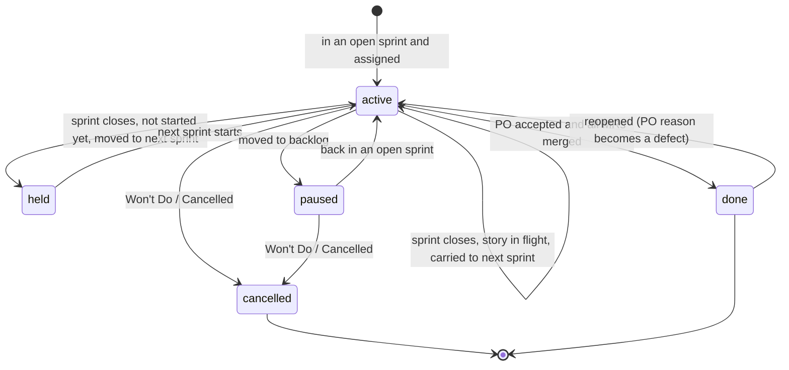

# Review notes on the Phase 1 plan

Review of [phase-1-plan.md](phase-1-plan.md) (artifact version `1795250480-83d2`), 2026-11-21.

Each item is a **proposal** to accept, change or reject. The plan file stays as it was until a proposal is accepted. Accepted items then go into the plan and into the decision log in [WORKFLOW.md](../workflow/WORKFLOW.md#13-decision-log).

## Summary

| ID | Gap | Severity | Plan sections affected | Decision |
| --- | --- | --- | --- | --- |
| G1 | GitLab MRs, review and merge are unspecified | Blocking | 0.1, 0.2, 1, 2, 3, 8, 9, 10, 11 | **applied** to the plan 2026-11-21 (§3a + edits listed below) |
| G2 | `ask_human` is called "MCP" in §10 but "no MCP server" in §5 | Fix | 0.3, 10 | **applied** to the plan 2026-11-21 |
| G3 | Local mode allows two writers to one Jira sprint; no restart recovery | Blocking | 0.2, 1, 2, 3, 3a, 6, 7, 8, 9, 10, 11 | **applied** to the plan 2026-11-21 |
| G4 | Sprint boundaries and story lifecycle in Jira | Important | 1, 3, 3b, 4, 8, 11 | **applied** to the plan 2026-11-21 |
| G5 | No way for a human to take over a Story × repo | Important | 0.4, 1, 2, 6a, 7, 8, 11 | **applied** to the plan 2026-11-21 |
| G6 | No Copilot cost budget; licence for automation unclear | Important | 1, 5a, 8, 10, 11 | **applied** to the plan 2026-11-21 (licence via G3) |
| G7 | Prompt injection from Jira, Confluence and MR text | Important | 1, 3a, 4, 5b, 10, 11, later phases | **applied** to the plan 2026-11-21 |
| G8 | No Phase 1 success criteria | Important | 8, 11, 12 (new) | **applied** to the plan 2026-11-21 |
| G9 | No list of open questions for the team | Important | 10, 13 (new) | **applied** to the plan 2026-11-21 |
| G10 | Retro effect check can be fooled by small samples and overlapping changes | Important | 0.4, 1, 7, 11 | **applied** to the plan 2026-11-21 |
| G11 | Execution model (sessions vs delegation) is implied, not stated | Clarify | 2, 5, 11 | **applied** to the plan 2026-11-21 |
| G12 | Metrics are per session only; no per-story rollup | Important | 0.4, 1, 3, 7, 8, 9, 11 | **applied** to the plan 2026-11-21 |

**Team answers, 2026-11-23:** most open questions are answered; see the Answer column in [plan §13](phase-1-plan.md#13-open-questions). The cost unit changed from premium requests to **AI credits**, so the G6 text below uses the old unit; the plan uses the new one.

Decisions made during review (no change needed to the plan):

- **The retrospective agent keeps the name "Coach".** It looks forward, is blame-free and uses SAFe vocabulary. The deterministic engine checks (schema validation, write scope, round limits) already play the "audit" role.

---

## G1. GitLab: MR creation, review and merge are unspecified (blocking)

The plan names branches `<KEY>/<repo>` and a "Merge PRs" gate. It never says who opens merge requests, with what credentials, or how the gate is detected. It also assumes GitHub, but **the team hosts its code on GitLab**.

GitHub Copilot is unaffected. The Copilot SDK/CLI runs locally in a git worktree and works with any git remote. Only GitHub-hosted Copilot features (the Copilot coding agent, Copilot code review on PRs) are out of reach, and the plan uses neither.

**Decision (2026-11-21): the engine opens the MR, not an agent.** The Developer agent writes the MR description; the engine publishes it.

- **Not the Developer agent:**
    - It would need a GitLab token in its session, which breaks the rule that agents hold no credentials.
    - An LLM calling the API can fail halfway or open a duplicate MR.
    - Rework attempts are fresh sessions that don't know an MR already exists.
- **Not the Reviewer agent:** opening the MR is a side effect of the Developer finishing, not part of reviewing. The Reviewer *uses* the MR's diff and pipeline result as inputs.

Proposal:

| Step | Who |
| --- | --- |
| Commit to `<KEY>/<repo>` in its worktree; write `mr-description.md` in the change folder (summary, AC covered, interfaces touched, assumptions, how to test) | Developer agent |
| Push the branch; open **one Draft MR per Story × repo** with that description and links to the Jira story and change folder. Opened when the Developer first reaches `review`, not at the first push. Idempotent per branch. | Engine |
| Wait for the MR pipeline (build, unit tests, lint); **the Reviewer starts only when it is green**. A red pipeline goes back to the Developer as a rework input, with no LLM review spent. | Engine |
| Post review findings as **MR discussion threads (comments only, never an approval)** | Engine, from the Reviewer's `review` artifact |
| Push QE (b)'s test code to the same branch | Engine |
| Remove Draft status when QE (c) passes; set labels | Engine |
| Approve and merge: **this is the merge gate** | Human (responsible dev), under the project's approval rules |
| Detect `merged` via webhook (polling as fallback); move Jira toward Done | Engine |

Details:

- **Credentials** (changed by G3 for Phase 1: each dev's engine uses the dev's own GitLab token; the group token or bot below applies to the later team host):
    - GitLab has no equivalent of a GitHub App. The engine uses a **group access token** (or a dedicated bot / service-account user) with role Developer and scope `api`, kept only in the engine.
    - Which token types are available depends on your GitLab tier and on self-managed vs GitLab.com; this is a spike question (G9).
    - Agents never get a GitLab token. They commit in their worktree, and the engine pushes.
- **The bot must never count as an approver.** Configure MR approval rules (and protected branches) so only humans can approve and merge into `main`. A bot comment can never pass the gate.
- **Multi-repo merge order:** follows `depends_on`. The engine keeps the downstream MR blocked ("waiting for upstream merge") until upstream merges. GitLab MR dependencies, where your tier has them, can enforce this in the UI as well.
- **Conflicts:** if an MR can't merge cleanly (for example, another story landed first), the Developer gets a `rebase` rework input. The pipeline, Reviewer and QE (c) rerun afterwards.
- **Story done:** the story moves to `done` in Jira only when the PO has accepted it **and** all its MRs are merged.
- **Jira link:**
    - The branch name `<KEY>/<repo>` and the key in the MR title let GitLab's Jira integration show branches, commits and MRs on the story's development panel.
    - Where that integration is on, the engine doesn't post MR links as Jira comments.
- **New `team.yaml` block** (replaces nothing; the token itself is in the engine's secret store, never in the overlay):

```yaml
gitlab:
  url: https://gitlab.corp
  token_ref: GITLAB_TOKEN            # name of the secret in the engine env / secret store
  mr:
    draft_until: qe_pass
    labels: [sdlc]
    reviewer_starts_on: pipeline_success
    jira_dev_panel: true             # rely on GitLab's Jira integration for links
repos:
  billing-api: {path: ../billing-api, gitlab_project: payments/billing-api, branch: main}   # plus the existing build/test keys
```

- **Plan edits:**
    - §3: add **§3a "GitLab: merge requests, review and merge"**, with a sequence diagram (Developer → engine push → Draft MR → pipeline → Reviewer threads → QE (c) pass → ready → human approves and merges → Jira done).
    - Diagram 0.1: add an MR node in ③/④; relabel the gate "Human approves and merges MR in GitLab".
    - Diagram 0.2: add GitLab next to Jira/Confluence.
    - §1 `team.yaml`: add the `gitlab:` block and `gitlab_project` per repo.
    - §2 loop: add "sync GitLab MR and pipeline state".
    - §3 outbound: "links: PRs" becomes "links: MRs (or GitLab's Jira dev panel)".
    - §8: team-server login via GitLab OAuth instead of GitHub OAuth (local mode keeps git identity).
    - §9: add `libs/integrations/gitlab.ts` (`@gitbeaker/rest`, token auth, webhook handler).
    - §10: add GitLab (token type, approval rules, webhooks, Jira integration) to the integration spike and to step 3.
    - §11: verification bullets:
        - the bot never approves and can't merge
        - only one MR per branch, even after a restart
        - the Reviewer waits for a green pipeline
        - a merge is detected
        - upstream MRs merge first
        - a conflict produces a rebase rework
        - the Jira dev panel shows the MR

## G2. Internal inconsistency: `ask_human` "MCP"

§10 step 5 says "`ask_human` MCP", while §5 says it is an in-process custom tool and no MCP server is needed.

Proposal: change §10 step 5 to "Copilot runner + hostgen + in-process `ask_human` tool + question routing". The §0.3 diagram participant already reads "ask_human tool / onUserInputRequest (engine, in-process)", so it only needs a check.

## G3. Who runs the engine, and where shared state lives (blocking)

§8 makes the service the single writer, but local mode lets every dev run their own engine against the same Jira sprint. That means two writers. The plan also never says how the engine recovers after a restart.

**Decisions (2026-11-21):**

- **Phase 1 runs on developers' own machines, with a shared lock.** A shared team host comes later.
- **Change folders are merged to `main` with the code.** The design and its reasons stay next to the code in history.

### Proposal: one owner per story, the Jira assignee

A single team-wide lock would mean one laptop drives every story, and all work stops when it sleeps. Instead, **each story is driven by the engine of its responsible dev**, which by default is the Jira assignee (the plan already uses this person for proposal approval and merge).

- **Intake filter:** each engine adds `AND assignee = currentUser()` to `intake_jql`. A story has exactly one assignee in Jira, so two people's engines never pick up the same story. **Unassigned stories are not started**; the Board shows them as "needs an assignee".
- **Story lease** (guards against the same dev running two machines):
    - The owning engine writes `stories/<KEY>/owner.json` (`user, host, engine_id, heartbeat_at`) to the shared workspace repo and refreshes the heartbeat every few minutes.
    - A `git push` is atomic, so the lease works as compare-and-swap. If the push is rejected, or another host holds a fresh lease, this engine leaves the story alone.
    - A lease older than `lease_ttl_minutes` (default 30) can be taken over.
- **Handover on reassignment:**
    - When the assignee changes in Jira, the old engine finishes or checkpoints its running session, pushes, and releases the lease.
    - The new assignee's engine continues from the workspace repo and the pushed branches.
    - Agents' work in progress is pushed at every checkpoint, so nothing is lost when a laptop goes away.

### Proposal: shared state in a workspace repo on GitLab

- **One repo, `<team>-sdlc-workspace`,** holds the overlay (`.sdlc/team/`) and the workflow state (`.sdlc/work/`).
- **Each engine writes only its own paths**, so pushes don't conflict:

| Path | Written by |
| --- | --- |
| `.sdlc/work/stories/<KEY>/` (artifacts, `owner.json`, `events.log`, `story-metrics`) | the story's owning engine |
| `.sdlc/work/retro/<KEY>/` (session metrics and retros) | the story's owning engine |
| `.sdlc/work/topics/<TOPIC>/` (PRD snapshots) | any engine; content-addressed by page version, so identical writes never conflict |
| `.sdlc/team/` (overlay) | humans and Coach (b), only through MRs |

- **`events.log` is per story** (`stories/<KEY>/events.log`) instead of one global file. The engine commits and pushes after each loop, which also gives history and a backup.
- **Coach (b) works across the whole team.** It reads the retros of all stories from the workspace repo. In Phase 1 it runs on `sdlc improve`, or on the engine whose retro just hit the recurrence threshold, holding a short team-level lease (`.sdlc/work/leases/coach.json`) so only one engine opens the MR.

### Proposal: what changes when the engine runs on a laptop

| Concern | Laptop engine (Phase 1) |
| --- | --- |
| Credentials | The dev's own Copilot seat, GitLab token and Atlassian token, stored in the OS keychain. **This also answers G6's licence question for Phase 1**: there is no shared service seat. |
| Jira and GitLab events | **Polling only**: a laptop can't receive webhooks. Jira every 2 min; GitLab MR and pipeline state every 1 min while MRs are open. |
| Humans other than the owner (PO, QE, SM) | They can't reach the dev's local Web UI, so they use **Jira and the team chat webhook**: questions are posted as Jira comments `@owner` and answered by replying in Jira. Gates: PO acceptance through the "Accepted" transition (already in the plan); **QE's approval of test scenarios through a Jira comment command** (`/sdlc approve scenarios`, accepted only from a member with role `qe`). |
| Laptop asleep or offline | That story pauses; other devs' stories carry on. A blocking question already uses the durable fallback (checkpoint, resume later). The Board, read from the workspace repo by any engine, shows "owner offline since …". |
| Toolchains | Agents' `mvn`, `pnpm` and test commands run on the dev's machine, which already has them. |
| Load | `limits.concurrency` applies per machine (default 2 on a laptop). |

### Proposal: restart recovery (any mode)

- **On start**, the engine pulls the workspace repo, then for each story it owns:
    - re-reads that story's `events.log`;
    - re-attaches `waiting` instances;
    - re-dispatches attempts that were running and never finished (same attempt number, new session; the worktree is restored from the pushed WIP branch).
- **Every outbound write is idempotent**, keyed by event id:
    - Jira comments carry a hidden marker; transitions are skipped if Jira already has that status.
    - GitLab allows only one open MR per source branch, so a retry finds the existing MR.
    - Discussion threads carry a marker in their text.

### Proposal: tools and modes

- **`sdlc run --dry-run`** reads real Jira and GitLab but writes nothing outbound. Artifacts go to a local scratch folder, not the workspace repo. Use it to try an overlay change on a real story before opening the overlay MR.
- **Later, team host:** the same engine with `owner: all` instead of `owner: assignee`. It holds one lease for the whole team, takes webhooks instead of polling, and serves the Web UI to everyone. Only configuration changes.

New `team.yaml` keys:

```yaml
runtime:
  mode: local                  # local (Phase 1) | team_host (later)
  owner: assignee              # assignee | all
  workspace_repo: payments/payments-sdlc-workspace
  lease_ttl_minutes: 30
  poll: {jira_seconds: 120, gitlab_seconds: 60}
gates_from_jira:
  story_acceptance: {transition: "Accepted"}
  scenario_approval: {comment_command: "/sdlc approve scenarios", role: qe}
limits: {concurrency: 2}       # per machine
```

### Plan edits when accepted

- **§2:**
    - loop step 1 pulls the workspace repo, and the last step pushes it;
    - the trigger rule only considers stories this engine owns;
    - add a "Story ownership and leases" subsection;
    - add "Restart recovery".
- **§3:** polling cadence in local mode; the QE scenario-approval comment command; ownership follows the Jira assignee.
- **§6:** for people other than the owner, questions go through Jira comments and the webhook.
- **§8:**
    - modes rewritten as "local (Phase 1, per-dev engine, per-story owner)" and "team host (later)";
    - the "single writer" becomes "single writer *per story*";
    - CLI adds `--dry-run` and `sdlc lease status|release`.
- **§9 layout:**
    - the team workspace is the `<team>-sdlc-workspace` GitLab repo, with per-story `events.log` and `leases/`;
    - add `libs/orchestrator/lease.ts` and `recovery.ts`.
- **§10:**
    - engine core includes leases and recovery;
    - the Atlassian spike checks that `assignee = currentUser()` works in the team's JQL and that the comment-command parsing is reliable.
- **§11:**
    - two engines of different devs never touch the same story;
    - the same dev on two machines: only one holds the lease;
    - reassignment hands over cleanly;
    - an engine killed mid-session recovers with no duplicate comments, MRs or threads;
    - dry-run writes nothing to Jira or GitLab;
    - QE approval works by Jira comment command only from role `qe`;
    - an unassigned story is not started.
- **Diagram 0.2:** the engine is drawn as "Engine (one per dev)", plus the workspace repo on GitLab.

## G4. Sprint boundaries and story lifecycle in Jira

Only "story leaves the sprint → pause" is covered today.

**Decisions (2026-11-21):**
- In-flight stories keep running across the sprint gap.
- A split creates a new story that uses the old story's work as reference.
- A cancelled story's MRs are closed and its branches kept.

The other cases use the defaults below.

| Jira event | Workflow behaviour |
| --- | --- |
| Any event that stops a story | A running agent session is never cut off mid-edit: it finishes or checkpoints, then no new work starts. |
| **Sprint closes; story in flight** (the Planner has produced at least one change folder) and carried to the next sprint | **Keeps running** through the gap, even if the next sprint isn't started yet. The engine keeps every owned in-flight story that sits in a future sprint. |
| Sprint closes; story not started yet, moved to the next sprint | **Held**: starts when the next sprint is started in Jira. |
| Moved to backlog | **Paused**: Draft MRs stay, open questions get no reminders, the lease is kept. Local worktrees are removed after `lifecycle.retention.paused_days` (default 14); branches stay on GitLab. |
| Back in an open sprint | Resumes: the normal staleness check runs against the current Jira version (AC changed while away → cascade), and the Developer rebases if `main` moved on. |
| **Story split** (a new story linked "split from" the original) | The **new story starts at the Planner as usual**, with the original story's change folders, `decisions-<KEY>.md` and MR links as extra read-only inputs. The original story finishes on its own Jira outcome; humans merge or close its MRs. |
| **Cancelled / Won't Do** | Sessions and open questions are cancelled. **Draft MRs are closed with a comment; branches are kept** (removed later by humans). Artifacts are marked `cancelled` and archived, never deleted. Story metrics are written. |
| Reopened after Done | The PO's reason (the reopening comment) becomes a `defect-*` for the Developer, on a new branch from `main` and a new MR (the old ones are merged). |
| Jira status changed by hand, out of the workflow's order | The engine doesn't fight it: it logs the drift and shows it on the Board, and its next transition applies normally. |
| Sprint closes with unfinished stories | Each owner's engine posts one summary comment per unfinished story (done so far, what's left, where it waits). If the laptop is off at close, it posts when next online. |

Story states (new diagram for the plan):



New `team.yaml` block:

```yaml
lifecycle:
  in_flight_after: planner              # a story counts as in flight once the Planner produced a change folder
  carry_over: keep_in_flight            # keep in-flight stories running when moved to a future sprint
  split: {link: "split from", reference_inputs: true}
  cancel: {statuses: ["Cancelled"], resolutions: ["Won't Do"], mrs: close, branches: keep}
  reopened: defect
  retention: {paused_days: 14}
```

Plan edits:

- **New §3b "Story lifecycle and sprint boundaries":** the table and the state diagram.
- **§3:** the "pauses its branch" sentence points to §3b.
- **§1 `team.yaml`:** add the `lifecycle:` block.
- **§4:** the Planner also takes the original story's work as reference input when the story was split.
- **§8:** the Board shows held, paused and cancelled stories, and status drift.
- **§11:** verification bullets for each row.

## G5. Human takeover of a Story × repo

A dev must be able to take work away from the agents, for example when the agent is stuck or the change is delicate.

**Decisions (2026-11-21):**
- A human can take over any step, per Story × repo.
- Human commits without a takeover are accepted, and the agents rebase onto them.
- A takeover needs a reason and counts as a Coach signal.

Applied as plan **§6a**:

A developer or QE can take one step of a Story × repo away from the agents, for example when an agent is stuck, has taken a wrong approach, or the change is delicate. **The story keeps its owner, lease and Jira status**; only the agents for that step stop.

- **`sdlc takeover <KEY> <repo> [--step …] --reason <reason>`** (also a Web UI button):
    - A running session first checkpoints and pushes its work.
    - A `[sdlc]` Jira comment records who took over and why.
    - The Board shows the step as "human".
- **Reason is required:** one of `stuck | wrong-approach | delicate-change | faster-by-hand | other` plus a short note.
- **QE (b) keeps writing test code** during a `develop` takeover, because those tests target the agreed interfaces, not the implementation.

| `--step` | Agents stopped | Who may take over | Handback `--at` |
| --- | --- | --- | --- |
| `develop` (default) | Developer + Code Reviewer for that repo | responsible dev | `develop` (agent continues the remaining tasks in `tasks.md`), `review` (Code Reviewer reviews the human code after a green pipeline), `qe` (skip the agent review; humans review in the MR) |
| `planner` | Planner for that repo's change folder | responsible dev | `gate`: the hand-written proposal goes to `proposal_approval` |
| `qe-write` | QE (b) for that repo | member with role `qe` | `qe-write` (agent continues) or `done` (human test code is final) |
| `qe-run` | QE (c) for the story | member with role `qe` | `judge`: the human records results; the engine builds `story-acceptance` or `defect-*` from them |

- **`sdlc handback <KEY> <repo> --at …`** restarts the workflow at the chosen stage, after checking the contract still holds:
    - the build passes;
    - `status.json` is valid;
    - for `develop`, `mr-description.md` exists. If it's missing, the Developer agent is asked to write only the description.
- **Human commits without a takeover** (a quick fix, pairing) are allowed on `<KEY>/<repo>` and logged as human:
    - **No agent running:** the commits are simply picked up.
    - **An agent session is running:** it finishes, then rebases onto them.
    - **A real conflict:** that repo pauses and the owner is asked through `ask_human`.

  Write-scope rules bind agents only, but a human edit inside `test_dirs` during QE (b) work is flagged to the QE.
- **Counters and metrics:**
    - Review and defect round counts carry on; human work doesn't add to them.
    - Takeover time is left out of agent metrics, and human work is never measured.
- **Self-improvement:** a takeover is a retro signal. Coach (a) writes a retro from the reason and the sessions before it, for example "Developer stuck on the same migration pattern". Repeated reasons can lead to an overlay MR (§7).

New `team.yaml` block:

```yaml
takeover:
  reasons: [stuck, wrong-approach, delicate-change, faster-by-hand, other]
  retro: true                           # a takeover is a Coach signal
```

Other plan edits:
- **§2:** the trigger skips steps that are taken over.
- **§7 and diagram 0.4:** a takeover is a retro signal.
- **§8 CLI:** adds `takeover | handback`.
- **§11:** 6 verification checks.

## G6. Copilot cost and licence

**Licence:** settled for Phase 1 by G3. Each developer's engine uses that developer's own Copilot seat. A shared service seat for automation only matters for the later team host (see G9).

**Decisions (2026-11-21):**
- **Limits:** a per-story cap plus a personal reserve.
- **At a limit:** switch to a cheaper fallback model, otherwise ask the owner. **Update (2026-11-21):** no `fallback_model` in Phase 1, so at a limit the story goes `blocked: budget` and the owner decides.
- **Visibility:** usage per story and agent for the team; per developer only to themselves.

Applied as plan **§5a**:

In Phase 1 each developer's engine runs agents on **that developer's own Copilot seat** (§2). So every agent session uses premium requests from the developer's monthly allowance. The workflow protects that allowance and keeps usage visible without measuring people.

- **Measuring:** the engine counts premium requests per session from the Copilot telemetry it already collects (§7). If Copilot doesn't report them directly (checked in the spike), it estimates them as model calls × that model's multiplier, kept in `budget.multipliers`. Counts roll up per story and per agent.
- **Limits:**

| Limit | Default | What it protects |
| --- | --- | --- |
| `limits.max_turns_per_session` | 60 | stops a runaway agent loop inside one session |
| `limits.premium_requests_per_story` | 150 | one story can't eat the month |
| `budget.personal_reserve.stop_at_share` | 0.7 of the dev's monthly allowance | keeps the rest for the developer's own Copilot use |

- **At 80% of a limit:** a warning goes to the owner (Web UI inbox, `sdlc budget`).
- **At 100%:**
    1. **Fallback model:** new sessions of that story switch to the agent's `fallback_model` from the overlay, for example a model with no premium multiplier. That model uses no premium requests, so work continues without touching the reserve.
    2. **No fallback model set:** the story goes `blocked: budget`. The owner decides: `sdlc budget raise <KEY> <n>` for that story, or a takeover (§6a).
    3. **Running sessions are never cut off;** the limits apply when a new session starts. `max_turns_per_session` is the exception: it ends the session cleanly with a checkpoint.
- **Choosing models per agent** is the main cost lever and an overlay setting, for example a strong model for the Planner and Code Reviewer, and a cheaper one for routine Developer work. A fallback-model switch is recorded on the session, so the retro can tell a quality drop from a model change.
- **Who sees what:**
    - **The team** (Board, the story's Jira summary, sprint views) sees usage **per story and per agent**.
    - **A developer's own monthly usage and reserve** are shown only to that developer, on their own machine.
    - Telemetry keeps describing agents, never people.
- **Monthly allowance:** depends on the Copilot plan and is set per developer in their local config (`~/.sdlc/config.yaml`), with a team default.

New and changed `team.yaml` keys:

```yaml
limits: {review_rounds: 2, defect_rounds: 3, concurrency: 2,        # concurrency per machine
         premium_requests_per_story: 150, max_turns_per_session: 60}
budget:
  personal_reserve: {stop_at_share: 0.7, monthly_allowance_default: 300}   # per-dev override in ~/.sdlc/config.yaml
  warn_at_share: 0.8
  multipliers: {"<model id>": 1, "<cheaper model id>": 0}            # used only if Copilot doesn't report premium requests
agents:
  developer: {model: "<copilot model id>", fallback_model: "<model with no premium multiplier>"}
```

Other plan edits:
- **§8:** the Board shows usage per story and agent; the CLI adds `budget show|raise`.
- **§10 Copilot SDK spike:** check premium-request reporting and choosing the model per session.
- **§11:** 6 verification checks.

## G7. Prompt injection and untrusted input

Jira text, Confluence pages, MR comments and repo files are untrusted input to the agents. Since G3, agents run on developers' own machines, so injected code run by a build would execute as the developer.

**Decisions (2026-11-21):**
- **Isolation:** process-level now, container per session later.
- **Network:** an allowlist.
- **Sensitive files:** write-denied unless the approved proposal lists them, and flagged on the MR.

Applied as plan **§5b**:

Jira stories, Confluence pages, MR comments, retros and repo files are **untrusted input** to the agents. Injected text could try to steer an agent. The serious case: an agent edits a build script or test, then runs `mvn verify` or `pnpm test`, and that code runs **on the developer's machine as the developer** (§2: Phase 1 runs on dev machines).

**Phase 1 uses process-level isolation; container isolation per session comes later** (see Later phases). The layers:

| Layer | Phase 1 rule |
| --- | --- |
| Prompts | Imported text (Jira, Confluence, MR threads, retro quotes) goes inside fenced "untrusted data" blocks. Base prompts say instructions inside them are never followed, only reported as a finding. |
| Secrets | The session environment is stripped: no Jira, GitLab or Atlassian tokens, and git credential helpers are disabled. The worktree's remote has no credentials. Only the engine pushes (§3a) and talks to Jira (§3). |
| Tools | `shell` only for the commands in `repos.*`; `web` off by default; every tool call is logged (§7). |
| Network | **Allowlist:** Copilot API, the team's GitLab, package registries (Maven, npm or the internal mirror) and the test environment. Phase 1 enforces it **best-effort** through a local allowlisting proxy the engine starts for each session (`HTTP(S)_PROXY`, plus Maven/npm proxy settings). Code that ignores proxy settings can bypass it until containers arrive. |
| Sensitive files | `security.sensitive_paths` (CI config, build scripts, dependency manifests and lockfiles, Dockerfiles, the overlay and generated agent files) are **write-denied by default**. A story unlocks only the paths its approved proposal lists in a required **"Sensitive changes"** section, with the reason and any new dependency. |
| MR flagging | The engine labels the MR `sdlc-sensitive` and lists each change to a sensitive path, and each new or upgraded dependency, at the top of the description. The Code Reviewer checks them against the proposal. |
| Human input | Jira answers count only from the routed person; comment commands only from the right role (§3, §6). |
| Human gates | Humans approve and merge every MR (§3a) and every overlay change. A Coach MR shows its evidence separately from the edit, and reviewers read the edit as code: it becomes instructions for future agents. |

**Optional hardening for Phase 1:** run the engine under a separate local Windows user. That user can't read the developer's home folder, SSH keys or browser data, but it can use its own Copilot, GitLab and Atlassian logins. This is still process-level, but it shrinks what a malicious build script can reach.

**What remains** until containers: code in the repo (tests, build plugins) runs with the engine user's rights during builds, and the network allowlist can be bypassed by code that ignores proxies. These risks are accepted for Phase 1 with sandbox projects (§11 "Real run"). Containers are the first item of the later phases.

New `team.yaml` block:

```yaml
security:
  isolation: process                    # process (Phase 1) | container (later)
  untrusted_fencing: true
  network:
    mode: allowlist                     # enforced via a local proxy per session in Phase 1 (best-effort)
    allow: [api.githubcopilot.com, gitlab.corp, repo.maven.apache.org, registry.npmjs.org, "*.test.corp"]
  sensitive_paths:                      # write-denied unless the approved proposal lists them
    - .gitlab-ci.yml
    - .gitlab/**
    - "**/pom.xml"
    - .mvn/**
    - "**/package.json"
    - "**/pnpm-lock.yaml"
    - .npmrc
    - "**/Dockerfile*"
    - "**/*.sh"
    - .sdlc/**
    - .github/agents/**
  engine_os_user: null                  # optional hardening: run the engine as a separate local user
```

Other plan edits:
- **§4 Planner:** the proposal requires a "Sensitive changes" section.
- **§3a:** MRs with sensitive changes are flagged.
- **§10 spike:** check the stripped environment and that the proxy is honoured.
- **§11:** 8 verification checks.
- **Later phases:** container isolation comes first.

## G8. Phase 1 success criteria

**Decisions (2026-11-21):**
- **Real run:** one sprint, 2 devs, ≥ 3 stories, after a sandbox run.
- **Speed:** measured against a baseline, with no target in Phase 1.
- **Sign-off:** the team decides at a retro, and the SM records it.

Applied as plan **§12**:

**Phase 1 is done when the team, at a sprint retro, agrees the criteria below are met.** The SM records the decision in the decision log of `docs/workflow/WORKFLOW.md`. The engine produces the criteria report with `sdlc metrics --phase1-report`.

**Runs:**

1. **Sandbox run:** ≥ 5 stories across ≥ 2 GitLab repos in a sandbox Jira project, owned by ≥ 2 developers' engines, complete the whole flow from intake to MR merge.
2. **Real run:** **one sprint, 2 developers, ≥ 3 real stories** through every gate. If a carry-over or reassignment happens naturally, it is handled per §3b and §2.

**Must be zero** (pass/fail, over both runs):

| Check | Source |
| --- | --- |
| Agent writes outside write scope, or to sensitive paths not listed in the approved proposal | write-scope check, `events.log` |
| Jira, Confluence or GitLab writes by agents; tokens found in an agent session | integration audit, session environment check |
| Duplicate MRs, Jira comments or MR threads (also after restarts and handovers) | idempotency markers |
| Two engines acting on the same story | leases, `events.log` |
| Sensitive changes or new dependencies reaching an MR without the `sdlc-sensitive` flag | MR audit |

**Targets:**

| Area | Target |
| --- | --- |
| Quality | median review rounds ≤ 1.5; median defect rounds ≤ 1 |
| Human effort | takeovers on ≤ 30% of Story × repo (the reasons are reviewed at the retro) |
| Cost | median premium requests per story ≤ `premium_requests_per_story` (150); no developer reaches their personal reserve without an earlier warning |
| Reuse | a second team overlay runs on the sandbox with no engine or pack change |
| Self-improvement | ≥ 1 Coach MR merged, with its effect checked by `sdlc metrics --compare-overlay` |

**Measured, no target in Phase 1** (speed targets start in Phase 2):

- **Baseline:** the team's median story cycle time (In Progress → Done) over the last 3 sprints, read from Jira history with `sdlc metrics --baseline`.
- **Phase 1 numbers,** reported next to the baseline:
    - median story lead time
    - agent time vs time waiting for humans, by role
    - takeover rate and reasons
    - premium requests per story and per agent

Other plan edits:
- **§11 "Real run":** points to §12.
- **§8 CLI:** `metrics --baseline | --phase1-report`.

The flow numbers (lead time, human wait share) come from the per-story rollup in **G12**, which is now applied.

## G9. Open questions for the team

**Applied (2026-11-21)** as plan **§13**. All open questions from G1–G8 are merged into one checklist, each with an owner role, the build step that needs it and an Answer column. The original five questions became:

| Original question | Now |
| --- | --- |
| 1. Shared Copilot seat for automation | Q18, team host only (Phase 1 uses each dev's own seat, G3/G6); Q2 adds the allowance and overage |
| 2. GitHub App approval | replaced by Q3/Q4 (GitLab tier, features, author approval) |
| 3. Per-story test environment | Q10 |
| 4. AC field and transitions | Q6 |
| 5. Pack process owner | Q16 |

New from G1–G8: Q1, Q5, Q7–Q9, Q11–Q15 and Q17. §10's spikes now point to the questions they answer.

## G10. Session retro loop: effect check and change isolation

Diagram 0.4 and §7 compare a metric before and after an `overlay_rev`. With a few stories per sprint, that comparison can be noise. G3–G6 add more distortion: the fallback model, takeovers, and several engines.

**Decisions (2026-11-21):**
- **Sample:** ≥ 5 sessions each side, at most 2 sprints.
- **Open MRs:** one per agent.
- **If worse:** a draft revert MR, and a human decides.
- **Low hit rate:** reported at the retro.

Applied to plan **§7** and diagram 0.4:

**Effect check.** An overlay change is judged only on comparable data:

- **Metrics:** each Coach MR names **one primary metric** (e.g. Developer review rounds) and gets **guardrail metrics** that must not get worse: premium requests per session, takeover rate, defect rounds.
- **Comparable sessions:**
    - sessions of the affected agent, pooled from all developers' engines through the workspace repo and tagged by `sdlc.overlay_rev`;
    - sessions on the `fallback_model` (§5a) and takeover periods (§6a) are left out.
- **Minimum sample:** ≥ 5 comparable sessions on each side of the overlay revision. If 2 sprints pass without enough sessions, the result is **inconclusive** and the change stays, unless reviewers decide otherwise.
- **One open Coach MR per agent:** while an agent's Coach MR is open or its effect check is still running, new findings for that agent wait. Changes to different agents can run in parallel.
- **If the primary metric or a guardrail got worse:** the Improvements view flags it, and the engine prepares a **draft revert MR**. A member of `improvement_reviewers` decides whether to merge it.
- **Coach hit rate:** the Improvements view shows Coach MRs opened, merged, rejected and reverted, and how many had their effect confirmed. It is part of the sprint retro data. The team decides whether to raise the recurrence threshold N, change the Coach's model, or pause Coach (b).

`sdlc metrics --compare-overlay <rev>` prints the comparison: sample sizes, primary and guardrail metrics before and after, and the verdict (better, worse, no change, inconclusive).

New `team.yaml` block:

```yaml
improvement:
  recurrence_threshold: 2              # N matching retros before Coach (b) opens an MR
  open_mrs: one_per_agent
  effect_check: {min_sessions_each_side: 5, max_sprints: 2,
                 guardrails: [premium_requests_per_session, takeover_rate, defect_rounds],
                 exclude: [fallback_model, takeover]}
  on_worse: draft_revert_mr
```

Plan §11 gets 5 verification checks.

## G11. Execution model: separate sessions, not delegation

The plan implied this, but no section stated it.

**Applied (2026-11-21)** as an "Execution model" block at the top of plan **§2**:

- **Execution model: a deterministic orchestrator, not an orchestrating agent.**
    - **The orchestrator is engine code, not an LLM.** It decides what runs from the contracts and artifact states (the trigger rule below). No model decides the flow.
    - **One Copilot SDK session per attempt.** An *instance* is one agent contract × Story × repo (when it fans out per repo); an *attempt* is one execution of it. Each attempt gets its own SDK session in its own git worktree, with only that agent's generated persona and skills. Ready instances run in parallel up to `limits.concurrency`.
    - **Agents never call each other.** The only handoff is artifacts on disk with `derived_from` hashes. A downstream agent sees approved artifacts, never another agent's conversation.
    - **Each attempt starts fresh.** Rework (a review, defect, red pipeline, rebase or answer) arrives as an extra input to a new session. The one exception is an `ask_human` wait: the same session continues live, or is resumed with `resumeSession` (§6).
    - **Sub-agents inside a session** (Copilot's own) are allowed, but only within that session's worktree, tool policy, write scope and network allowlist (§5b).
    - **Why:**
        - triggering is reproducible;
        - permissions and write scope are enforced per session;
        - waits of hours or days survive restarts (§2 recovery);
        - coordination costs no tokens;
        - every transition is an auditable event;
        - one session is one unit for metrics and retros (§7).

Other plan edits:
- **§5 Session row:** "one SDK session per attempt".
- **§11:** 3 verification checks.

## G12. Per-story metrics rollup

Today metrics are per session (`session-<instance>-<attempt>.metrics.json`), tagged with `sdlc.story`. A story typically has 8–15 sessions, and nothing rolls them up. G8's criteria, G6's budget and G10's guardrails need story-level numbers.

**Decisions (2026-11-21):**
- **Jira:** a one-line summary comment.
- **Story retros** on PO rejection, defect rounds ≥ 2, over budget, or human wait > 60%.
- **Sprint rollups** are computed on read.

Applied to plan **§7** and diagram 0.4:

**Per-story metrics.** A story produces many sessions: Planner, the three QE steps, Developer and Reviewer per repo, plus rework. When a story is done or cancelled, its owning engine writes **`story-metrics-<KEY>.json`** to `stories/<KEY>/` in the workspace repo. No LLM call is needed. The Board shows a live version while the story is open.

| Group | Metrics |
| --- | --- |
| Effort | sessions and attempts by agent × repo; premium requests (§5a); fallback-model sessions; takeovers and their reasons (§6a) |
| Quality | review rounds and defect rounds per repo; proposal rejections; PO rejections; overturned assumptions; red MR pipelines; escaped defects (added later) |
| Flow | lead time from intake to done; time per stage (refine → build → review → QE → accept → merge); **agent time vs time waiting for humans, per role** (never per person) |
| Questions | count by category; blocking vs non-blocking; median answer time |
| Outcome | done, carried over, split or cancelled (§3b); AC coverage from the acceptance pack |

- **Jira:** at done or cancel, one `[sdlc]` comment on the story, for example: `11 sessions · 1 review round · 0 defects · 2 questions · 3.2 days (61% waiting for humans) · 84 premium requests`. Full detail stays on the Board and in the workspace repo.
- **Story retro:** Coach (a) also runs once per story when the story ends with a story-level signal (`metrics.story_retro`):
    - PO rejection;
    - defect rounds ≥ 2;
    - over the story budget;
    - human-wait share > 60% of lead time.

  The story retro links the related session retros, and still names one agent + overlay file as the fix target, so Coach (b)'s recurrence counting is unchanged.
- **Sprint rollups are computed on read.** `sdlc metrics --sprint <id>`, the Board and `--phase1-report` (§12) aggregate the story-metrics files whenever asked. Nothing extra is written, so no engine needs a lease.

New `team.yaml` block:

```yaml
metrics:
  jira_summary: one_line                # one_line | none
  story_retro: {po_rejection: true, defect_rounds_at_least: 2, over_budget: true, human_wait_share_above: 0.6}
  sprint_rollup: on_read
```

Other plan edits:
- **§3:** the summary is added to the outbound Jira comments.
- **§8 CLI:** `metrics --sprint`.
- **§9:** `story-metrics.ts`.
- **§11:** 5 verification checks.
