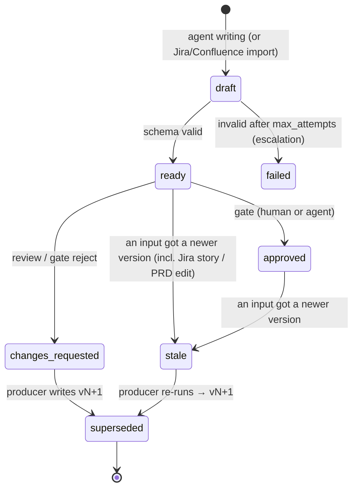
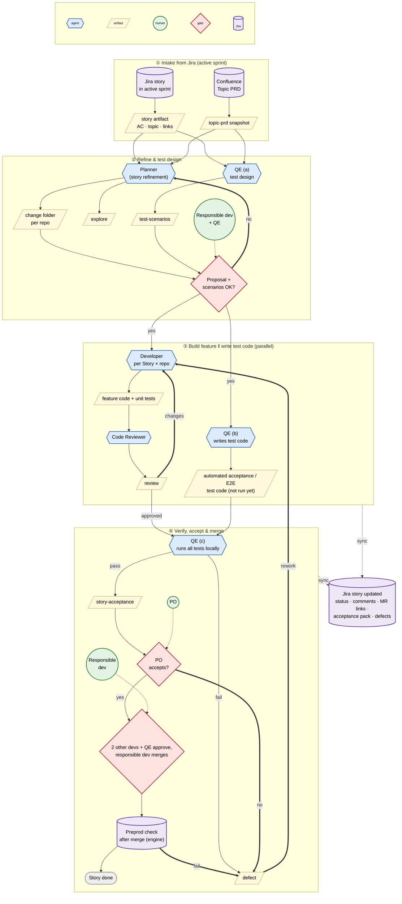
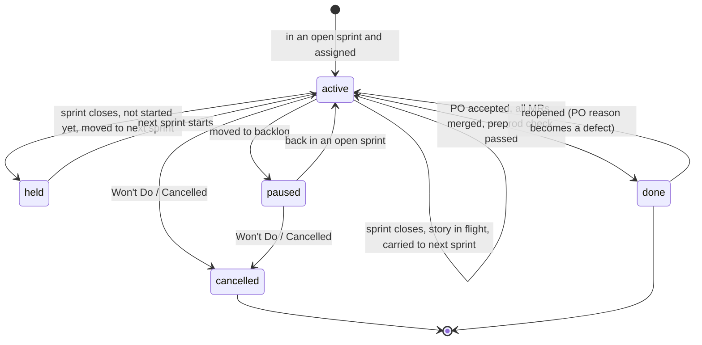
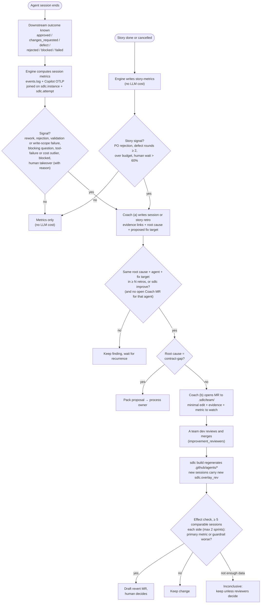

# Agentic SDLC Workflow — Reference

This is the reference for how the workflow works. Read it before proposing any change to the workflow. It describes the design in [phase-1-plan.md](../plan/phase-1-plan.md); items marked **(proposed, Gn)** come from [review-notes.md](../plan/review-notes.md) and are not decided yet.

- **Status:** design (Phase 1 plan approved 2026-11-23). Nothing is built yet.
- **Last updated:** 2026-11-21
- **How to update this file:** when a change is accepted, edit the affected section, remove its "(proposed)" label, and add an entry to the [Decision log](#13-decision-log).

## Contents

1. [Purpose and scope](#1-purpose-and-scope)
2. [Glossary](#2-glossary)
3. [Execution model](#3-execution-model)
4. [Agent catalogue](#4-agent-catalogue)
5. [Artifact catalogue](#5-artifact-catalogue)
6. [Flow](#6-flow)
7. [Humans in the loop](#7-humans-in-the-loop)
8. [Integrations](#8-integrations)
9. [Observability and metrics](#9-observability-and-metrics)
10. [Self-improvement loop](#10-self-improvement-loop)
11. [How to change the workflow](#11-how-to-change-the-workflow)
12. [Invariants](#12-invariants)
13. [Decision log](#13-decision-log)
14. [Open questions](#14-open-questions)

## 1. Purpose and scope

The workflow takes a **Jira user story in the active sprint** and carries it through refinement, test design, implementation, code review, test execution, PO acceptance and merge. Each step is done by an AI agent on GitHub Copilot, with humans at defined gates.

- **Starting point:** at PI Planning each Topic has a PRD in Confluence, and the team creates the stories in Jira. Being in the active sprint means the story is committed.
- **Reusable:** the engine and the process pack are shared. Each team changes only its own overlay (instructions, skills, settings).
- **In scope for Phase 1:** 5 agents (Planner, QE, Developer, Code Reviewer, Coach); multi-repo stories; two-way Jira sync; read-only Confluence PRDs; CLI + Web UI; live answers from humans; a retrospective after each agent session.
- **Out of scope for Phase 1:**
    - writing PRDs
    - breaking features into stories
    - PI-level planning
    - iteration and PI reports
    - SAFe I&A
    - a Claude Code runtime

## 2. Glossary

| Term | Meaning |
| --- | --- |
| Story | A Jira user story in the active sprint; key like `PAY-123`. Imported as artifact `story-<KEY>`. |
| Topic | The Epic/Feature a story belongs to; it links to a Confluence PRD. |
| PRD | Product requirements page in Confluence for a Topic. Imported read-only as `topic-prd-<TOPIC>`. |
| AC | Acceptance criteria of a story, numbered `<KEY>-AC<n>`. |
| Artifact | A versioned file with a front-matter envelope (`id, type, version, status, produced_by, derived_from`). The only way agents pass work to each other. |
| Contract | The definition of an agent step: inputs, rework inputs, outputs, fan-out, workdir, write scope, tools, gate. Lives in the pack. |
| Instance | One run target of a contract: contract × Story × repo (when it fans out per repo). |
| Attempt | One execution of an instance. Rework creates a new attempt. |
| Session | One Copilot SDK session. One attempt = one session (resumed only after an `ask_human` wait). |
| Gate | A status change that a human (or agent, if configured) must make before the flow continues, for example `proposal_approval` or `story_acceptance`. |
| Engine | The platform: orchestrator, artifact store, integrations, runner, service, UI. Maintained by platform maintainers. |
| Pack | `safe-scrum@1`: agent roster, contracts, schemas, templates, base prompts. Owned by the process owner (Phase 1: the SM). |
| Overlay | `.sdlc/team/`: a team's `team.yaml`, per-agent `instructions.md` and skills. Owned by the team, changed through MRs. |
| Change folder | `<repo>/.team/changes/<KEY>/`: per-repo proposal, tasks, test scenarios, `mr-description.md` and `status.json` for a story. Merged to `main` with the code. |
| Staleness | An artifact is stale when one of its inputs has a newer version. Stale outputs are regenerated. |
| Rework input | An artifact that sends work back to its producer: `review` (changes requested), `defect-*`, an answer. |
| Responsible dev | The human developer who approves proposals, answers technical questions and merges. By default the Jira assignee. In Phase 1 also the story **owner**: their engine drives the story. |
| Owner / lease | The engine that drives a story: its Jira assignee's engine. It holds `stories/<KEY>/owner.json` in the workspace repo, with a heartbeat; a stale lease (older than `lease_ttl_minutes`) can be taken over. |
| Workspace repo | `<team>-sdlc-workspace` on GitLab: the overlay plus all workflow state (`.sdlc/work/`). Every dev's engine clones it, and each engine writes only the paths of the stories it owns. |
| Signal | A session outcome that warrants a retro: rework, rejection, validation or write-scope failure, blocking question, tool-failure or cost outlier, `blocked`, or a human takeover (with its reason). |
| AI credit | Copilot's usage unit for agent sessions and model calls. Each developer has 50,000 per month. In Phase 1 agents use the story owner's own seat, so they consume that developer's monthly allowance. |
| Takeover | A human takes one step of a Story × repo from the agents (`sdlc takeover`), then returns it with `sdlc handback --at …`. |

## 3. Execution model

- **The orchestrator is deterministic engine code, not an LLM.** Each loop:
    1. sync Jira and Confluence
    2. mark stale artifacts
    3. evaluate the contracts
    4. dispatch ready instances
    5. validate the outputs
    6. check write scope
    7. retry or escalate
    8. append to `events.log`
    9. push status to Jira
- **Trigger rule (like `make`):** an instance runs when all its inputs are satisfied **and** its output is missing, its output is stale, or a rework/answer input targets it. It must not be locked, disabled, or taken over by a human.
- **One Copilot SDK session per attempt**, in its own git worktree. Only that agent's generated persona (`.github/agents/sdlc-<agent>.agent.md`) and skills are present. Ready instances run in parallel, up to `limits.concurrency`.
- **Agents never call each other.** Handoff happens only through artifacts on disk, with `derived_from` hashes. Downstream agents see artifacts, never another agent's conversation.
- **Each attempt starts a fresh session**, with any rework artifact as an extra input. The exception is the `ask_human` wait: the same session continues (live) or is resumed with `resumeSession(sessionId)`.
- **Sub-agents inside a session:** Copilot's own in-session sub-agents or tools may be used, within the same worktree, tool policy, write scope and network allowlist.
- **The engine is the only writer** to the workspace repo, Jira and GitLab (it pushes branches and opens MRs; agents only commit in their worktree). The CLI, Web UI, webhook replies and the `/sdlc` skill are thin clients of the NestJS service.
- **Where it runs (Phase 1):** one engine per developer machine, using the dev's own Copilot seat, GitLab token and Atlassian token, and polling instead of webhooks. **Each story is driven only by its Jira assignee's engine**: intake adds `assignee = currentUser()` and the engine holds a per-story lease. That makes it the single writer *per story*. Unassigned stories are not started. When the assignee changes, the story is handed over to the new assignee's engine.
- **Shared state:** the workspace repo, pulled and pushed every loop. Paths are disjoint per story, so engines never conflict. `events.log` is per story.
- **Restart recovery:**
    - Replay the story's `events.log`, re-attach `waiting` instances, and re-dispatch unfinished attempts from the pushed WIP branch.
    - Every outbound write is idempotent (event-id markers; one MR per source branch).
- **Later (team host):** the same engine with `owner: all`, webhooks and a bot identity. Only configuration changes.
- **Security (Phase 1 is process-level; containers come later):**
    - untrusted text is fenced in prompts;
    - sessions get no tokens or credential helpers;
    - `shell` only for allowlisted commands, `web` off;
    - the network allowlist goes through a per-session local proxy, which is best-effort;
    - sensitive paths are write-denied unless the approved proposal lists them;
    - sensitive changes and new dependencies are flagged on the MR.

  Remaining risk: repo code run by builds executes with the engine user's rights. Optional hardening: run the engine as a separate OS user.

Why this model: reproducible triggering, per-session permission and write-scope enforcement, waits of hours or days that survive restarts, no tokens spent on coordination, an auditable event trail, and one session = one retro unit.

## 4. Agent catalogue

Overlay knobs available for every agent: `instructions.md`, skills, `model`, `fallback_model` (not set in Phase 1), `enabled`, limits, gate mode. The overlay can never change an agent's inputs or outputs.

### 4.1 Planner — story refinement

| Field | Value |
| --- | --- |
| Trigger | A new or changed `story-<KEY>` (with its `topic-prd`) |
| Inputs | `story`, `topic-prd`; all repos read-only; for a split story, the original story's change folders, decisions and MR links (read-only) |
| Rework inputs | rejected proposal (gate `proposal_approval` = no); answers to its questions |
| Outputs | `explore-<KEY>` (affected repos, reuse, risks); per affected repo a change folder: `proposal` (required sections **"Interfaces & test hooks"**: endpoints and schemas, events, UI test IDs, seed data; and **"Sensitive changes"**: sensitive paths to unlock, new dependencies, why), `tasks` mapped to AC IDs, `status.json` = draft |
| Write scope | the change folders and `explore`; no source code |
| Questions | `always_ask` by default; asks the PO when AC is missing or untestable, or conflicts with the PRD. Never invents requirements. |
| Gate | `proposal_approval` (responsible dev + QE, together with the test scenarios) |
| First overlay | built from the `wf-plan` skill |

### 4.2 QE (a) — define test cases

| Field | Value |
| --- | --- |
| Trigger | `story` + `topic-prd` + `explore` ready (runs in parallel with the Planner's change folders) |
| Outputs | `test-scenarios.md` per repo: ≥ 1 Given/When/Then case per AC, with its level (unit/API/contract/E2E), test data and expected result |
| Runs tests | No |
| Gate | approved together with the proposal (`proposal_approval`) |

### 4.3 QE (b) — write test automation code

| Field | Value |
| --- | --- |
| Trigger | `proposal_approval` passed; runs **in parallel with the Developer** |
| Inputs | approved change folder (proposal interfaces + test scenarios) |
| Outputs | executable acceptance/E2E test code on the Story branch, in a separate worktree |
| Write scope | `write_allow: test_dirs` only |
| Self-check | compiles/lints; a dry run fails **for the right reason** (404, element not found), never a syntax error |
| Overlay knobs | `qe.automation: required \| optional` |

### 4.4 QE (c) — run and judge

| Field | Value |
| --- | --- |
| Trigger | all repos of the story are code-review approved **and** QE (b) is done |
| Actions | the **engine** starts the story's repos locally on the owner's machine (`qe.local_env`); QE runs acceptance + E2E + regression (`qe.regression_scope: affected \| full`) against it and attaches E2E evidence. After merge, a **preprod check** runs under the team lease `preprod.json`, and a failure creates a defect. Unmerged builds never go to preprod. |
| Outputs | `story-acceptance` (AC → test → result matrix) or `defect-*` |
| Failure classification | **product bug** → `defect-*` to the Developer (≤ `defect_rounds`) and to Jira per `defects.mode`; **test bug** → QE fixes its test once and reruns (if the interface drifted without a proposal update, it asks the responsible dev instead); **environment** → `blocked`, routed to the SM |
| Gate | `story_acceptance` (PO, in the Web UI or by the "Accepted" transition in Jira) |

### 4.5 Developer — per Story × repo

| Field | Value |
| --- | --- |
| Trigger | `proposal_approval` passed; upstream repos (by `depends_on`) at least in review |
| Inputs | approved change folder (proposal + scenarios) |
| Rework inputs | `review` (changes requested), `defect-*`, answers, a red MR pipeline, `rebase` on merge conflict |
| Outputs | feature code + unit tests on branch `<KEY>/<repo>`; `mr-description.md` in the change folder (summary, AC covered, interfaces touched, assumptions, how to test); `status.json` → `review` or `blocked`. The engine pushes and opens the MR; the Developer never calls GitLab. |
| Write scope | the repo, except `write_deny: test_dirs` |
| Self-check | build + unit tests; may also run QE (b)'s tests once they are pushed (ATDD), but passing them is not required to reach review |
| Questions | `assume_if_low_risk` by default |
| First overlay | built from the `team-apply` skill |

### 4.6 Code Reviewer

| Field | Value |
| --- | --- |
| Trigger | change `status = review` **and** the MR pipeline is green |
| Inputs | the MR diff, pipeline result, change folder, `mr-description.md` |
| Outputs | `review`: approve or changes_requested; checks every recorded assumption |
| Limits | at most `review_rounds` (default 2), then escalation |
| GitLab | the engine posts the findings as MR discussion threads; never an MR approval. The verdict is a workflow status, not a GitLab approval. |

### 4.7 Coach (a) — session retro

| Field | Value |
| --- | --- |
| Trigger | a session reached its outcome **and** there is a signal (clean sessions get metrics only); also once per story when it ends with a story-level signal: PO rejection, defect rounds ≥ 2, over budget, human wait > 60% |
| Inputs | `session-<instance>-<attempt>.metrics.json`, `events.log`, Copilot OTLP data, the outcome artifacts |
| Outputs | `retro/session-….md`: evidence links, one root cause from the taxonomy (§10), a concrete fix in a specific overlay file |
| Side output | `unclear-input` findings summarized for the PO as Definition-of-Ready feedback |

### 4.8 Coach (b) — overlay improvement

| Field | Value |
| --- | --- |
| Trigger | same root cause + agent + fix target in ≥ N retros (default 2), or `sdlc improve` |
| Outputs | an `overlay-change` branch for `.sdlc/team/` (minimal edit, evidence, metric to watch), which the engine opens as an MR; `contract-gap` findings become a pack proposal for the process owner |
| Write scope | `.sdlc/team/` only |
| Gate | a team dev in `improvement_reviewers` reviews and merges |
| Limits | one open Coach MR per agent at a time (including its running effect check) |

## 5. Artifact catalogue

| Artifact | Producer | Consumers | Location |
| --- | --- | --- | --- |
| `story-<KEY>` | engine (Jira import) | Planner, QE (a) | `.sdlc/work/stories/<KEY>/` |
| `topic-prd-<TOPIC>` | engine (Confluence import, stores page version) | Planner, QE (a) | `.sdlc/work/topics/<TOPIC>/` |
| `explore-<KEY>` | Planner | QE (a), humans at the gate | `.sdlc/work/stories/<KEY>/` |
| change folder: `proposal`, `tasks`, `status.json` | Planner (status updated by engine and Developer) | Developer, QE (b), gate | `<repo>/.team/changes/<KEY>/` |
| `test-scenarios` | QE (a) | QE (b), QE (c), gate | change folder |
| test code | QE (b) | QE (c), Developer (self-check) | `test_dirs` on branch `<KEY>/<repo>` |
| feature code + unit tests | Developer | Code Reviewer, QE (c) | branch `<KEY>/<repo>` |
| `mr-description.md` | Developer | engine (MR description), Code Reviewer, humans | change folder |
| merge request | engine (Draft at the Developer's first `review`; ready when QE (c) passes) | Code Reviewer (diff, pipeline), responsible dev (approve + merge) | GitLab project of the repo |
| `review` | Code Reviewer | Developer (rework), QE (c) trigger | change folder |
| `story-acceptance` | QE (c) | PO gate, Jira comment | `.sdlc/work/stories/<KEY>/` |
| `defect-*` | QE (c), or PO rejection | Developer (rework), Jira | `.sdlc/work/stories/<KEY>/` |
| `questions/Q-<n>.md` | engine (from `ask_human`) | humans, the asking agent | `.sdlc/work/stories/<KEY>/` |
| `decisions-<KEY>.md` | engine (all Q&A) | all later agents of the story | `.sdlc/work/stories/<KEY>/` |
| `session-<instance>-<attempt>.metrics.json` | engine | Coach (a), metrics views | `.sdlc/work/retro/<KEY>/` |
| `retro/session-….md` | Coach (a) | Coach (b) (reads all stories' retros), team | `.sdlc/work/retro/<KEY>/` |
| `owner.json` (story lease) | owning engine | other engines, Board | `.sdlc/work/stories/<KEY>/` |
| `overlay-change` MR | Coach (b) | `improvement_reviewers` | MR to `.sdlc/team/` |
| `story-metrics-<KEY>.json` | owning engine (at done or cancel) | Board, one-line Jira comment, story retro, sprint rollup (computed on read) | `.sdlc/work/stories/<KEY>/` |
| `events.log` (one per story) | owning engine | retro, restart recovery, audit | `.sdlc/work/stories/<KEY>/` |

**Envelope** (front matter of every artifact): `id, type, version, status, produced_by, derived_from[{id, version, hash}]`. **`status.json`** in a change folder: `state, depends_on, proposal_approved_by, review_rounds, blocked_reason`.

**Lifecycle:**

## 6. Flow

| Stage | Agent(s) | Gate (who) | Jira status (`status_map`) |
| --- | --- | --- | --- |
| ① Intake | engine sync | — (being in the active sprint = committed) | — |
| ② Refine & test design | Planner, QE (a) | `proposal_approval` (responsible dev + QE) | In Refinement |
| ③ Build ‖ write tests | Developer per repo, QE (b), then Code Reviewer | review verdict (agent), ≤ `review_rounds` | In Progress → In Review |
| ④ Verify | QE (c), on the owner's machine | — (defects loop back, ≤ `defect_rounds`) | In QA |
| ④ Accept | — | `story_acceptance` (PO, Web UI or Jira "Accepted") | Ready for Acceptance |
| ④ Merge | — | at least two other developers and a QE approve each MR (GitLab approval rule); the responsible dev merges, upstream first; detected by polling | Done (only when accepted **and** all MRs merged) |

Rework paths (thick arrows in the diagram): proposal rejected → Planner; changes requested → Developer; defect or PO rejection → Developer.

## 7. Humans in the loop

**Roles** (from `team.yaml` `members`): `po`, `dev`, `qe`, `sm`. The **responsible dev** is the story's Jira assignee, with `per_repo_override`; an unassigned story is not started (`fallback: none`). Reassigning the story in Jira hands the story, its open approvals and technical questions over to the new assignee's engine and inbox.

**Gates:**

| Gate | Who | Channels |
| --- | --- | --- |
| `proposal_approval` | responsible dev + QE | responsible dev: their Web UI or CLI (`sdlc approve/reject`). QE: Jira comment command `/sdlc approve scenarios` (counts only from role `qe`) |
| `story_acceptance` | PO | Web UI, CLI (`sdlc accept`), Jira transition "Accepted" |
| merge | ≥ 2 other developers + a QE approve; the responsible dev merges | GitLab approval rule (the author and the engine never count) |
| overlay-change MR | `improvement_reviewers` | GitLab MR approval |

**Questions (`ask_human`):**

1. **Routing:** an agent calls `ask_human(question, options, recommended, blocking, category)`. The question is routed by category: `requirement → po`, `technical → responsible_dev`, `test → qe`, `environment → sm`.
2. **Notification:** to the story owner, through their Web UI inbox and `sdlc questions`. In Phase 1 only the owner can reach that UI, so anyone else (PO, QE, SM) gets **a Jira comment `@person` plus the chat webhook**, and answers by replying in Jira.
3. **Live window** (`live_wait_minutes`, default 20): the tool call stays open, and an answer comes back as the tool result.
4. **No answer in time:** `NO_ANSWER_YET`; the session is checkpointed and the instance becomes `waiting`. Only that branch pauses. A late answer resumes the session with `resumeSession`, falling back to a fresh session given the Q&A + worktree.
5. **Non-blocking questions:** the agent proceeds with `recommended` as a recorded assumption, which the Reviewer and QE check.
6. **Requirement answers** ask the PO to update Jira or the PRD. Agents never edit them.
7. **Reminders and record:** an SLA reminder fires after `sla_hours`. All Q&A goes to `decisions-<KEY>.md`.

**Question policy per agent** (`questions.policy`): Planner `always_ask`; Developer and QE `assume_if_low_risk`.

**Takeover and handback:**

A developer or QE can take one step of a Story × repo away from the agents, for example when an agent is stuck, has taken a wrong approach, or the change is delicate. **The story keeps its owner, lease and Jira status**; only the agents for that step stop.

- **`sdlc takeover <KEY> <repo> [--step …] --reason <reason>`** (also a Web UI button):
    - A running session first checkpoints and pushes its work.
    - A `[sdlc]` Jira comment records who took over and why.
    - The Board shows the step as "human".
- **Reason is required:** one of `stuck | wrong-approach | delicate-change | faster-by-hand | other` plus a short note.
- **QE (b) keeps writing test code** during a `develop` takeover, because those tests target the agreed interfaces, not the implementation.

| `--step` | Agents stopped | Who may take over | Handback `--at` |
| --- | --- | --- | --- |
| `develop` (default) | Developer + Code Reviewer for that repo | responsible dev | `develop` (agent continues the remaining tasks in `tasks.md`), `review` (Code Reviewer reviews the human code after a green pipeline), `qe` (skip the agent review; humans review in the MR) |
| `planner` | Planner for that repo's change folder | responsible dev | `gate`: the hand-written proposal goes to `proposal_approval` |
| `qe-write` | QE (b) for that repo | member with role `qe` | `qe-write` (agent continues) or `done` (human test code is final) |
| `qe-run` | QE (c) for the story | member with role `qe` | `judge`: the human records results; the engine builds `story-acceptance` or `defect-*` from them |

- **`sdlc handback <KEY> <repo> --at …`** restarts the workflow at the chosen stage, after checking the contract still holds:
    - the build passes;
    - `status.json` is valid;
    - for `develop`, `mr-description.md` exists. If it's missing, the Developer agent is asked to write only the description.
- **Human commits without a takeover** (a quick fix, pairing) are allowed on `<KEY>/<repo>` and logged as human:
    - **No agent running:** the commits are simply picked up.
    - **An agent session is running:** it finishes, then rebases onto them.
    - **A real conflict:** that repo pauses and the owner is asked through `ask_human`.

  Write-scope rules bind agents only, but a human edit inside `test_dirs` during QE (b) work is flagged to the QE.
- **Counters and metrics:**
    - Review and defect round counts carry on; human work doesn't add to them.
    - Takeover time is left out of agent metrics, and human work is never measured.
- **Self-improvement:** a takeover is a retro signal. Coach (a) writes a retro from the reason and the sessions before it, for example "Developer stuck on the same migration pattern". Repeated reasons can lead to an overlay MR (§7).

## 8. Integrations

**Only the engine talks to external systems.** Agents never hold Jira, Confluence or GitLab credentials; they see imported artifacts only.

| System | Direction | What |
| --- | --- | --- |
| Jira | in (polled in Phase 1) | stories matching `intake_jql` (active sprint) and assigned to this engine's user: summary, description, AC (mapped field), topic, priority, blocking links → `depends_on`, repo hints; new versions on edits; "Accepted" transition → gate; `/sdlc approve scenarios` comment → QE's approval; comment replies → answers |
| Jira | out | status transitions per `status_map`; comments (proposal summary, questions, blocked reasons, acceptance pack); links (MRs, change folders; the engine posts MR links while GitLab's Jira integration is disabled, `jira_dev_panel: false`); defects per `defects.mode` (`subtask \| linked_bug \| comment`) |
| Confluence | in (read-only) | the Topic's PRD page → `topic-prd` snapshot with page version |
| GitLab | out / in | via GraphQL (REST where needed); the org's GitLab MCP server is never given to agents. Push branches; open one Draft MR per Story × repo with the Developer's `mr-description.md`; post Reviewer findings as discussion threads; mark ready when QE (c) passes; read pipeline, mergeability and merge state (webhook, polling fallback). Auth in Phase 1: the dev's own token in the OS keychain, held only by their engine (MRs and threads appear under the dev's name, prefixed `[sdlc]`). On a later team host: a group access token or bot/service-account user. |
| Copilot | engine-managed | SDK sessions, OTLP telemetry |

**Story lifecycle (sprint boundaries, backlog, split, cancel, reopen):**

| Jira event | Workflow behaviour |
| --- | --- |
| Any event that stops a story | A running agent session is never cut off mid-edit: it finishes or checkpoints, then no new work starts. |
| **Sprint closes; story in flight** (the Planner has produced at least one change folder) and carried to the next sprint | **Keeps running** through the gap, even if the next sprint isn't started yet. The engine keeps every owned in-flight story that sits in a future sprint. |
| Sprint closes; story not started yet, moved to the next sprint | **Held**: starts when the next sprint is started in Jira. |
| Moved to backlog | **Paused**: Draft MRs stay, open questions get no reminders, the lease is kept. Local worktrees are removed after `lifecycle.retention.paused_days` (default 14); branches stay on GitLab. |
| Back in an open sprint | Resumes: the normal staleness check runs against the current Jira version (AC changed while away → cascade), and the Developer rebases if `main` moved on. |
| **Story split** (a new story linked "split from" the original, or naming it in a "split from <KEY>" comment) | The **new story starts at the Planner as usual**, with the original story's change folders, `decisions-<KEY>.md` and MR links as extra read-only inputs. The original story finishes on its own Jira outcome; humans merge or close its MRs. |
| **Cancelled / Won't Do** | Sessions and open questions are cancelled. **Draft MRs are closed with a comment; branches are kept** (removed later by humans). Artifacts are marked `cancelled` and archived, never deleted. Story metrics are written. |
| Reopened after Done | The PO's reason (the reopening comment) becomes a `defect-*` for the Developer, on a new branch from `main` and a new MR (the old ones are merged). |
| Jira status changed by hand, out of the workflow's order | The engine doesn't fight it: it logs the drift and shows it on the Board, and its next transition applies normally. |
| Sprint closes with unfinished stories | Each owner's engine posts one summary comment per unfinished story (done so far, what's left, where it waits). If the laptop is off at close, it posts when next online. |

**Change detection:**

- An edit to a story's AC or description creates a new artifact version, and staleness cascades downstream.
- A change folder already in progress becomes `blocked` ("story changed") instead of being rewritten.
- A story that leaves the sprint follows the lifecycle table above.

## 9. Observability and metrics

- **Per session:** `session-<instance>-<attempt>.metrics.json`, built from `events.log` (inputs, duration, waits, validation/write-scope failures, questions, assumptions) and Copilot OTLP (model calls, tokens, latency, tool calls, errors, retries). It is written when the session's output reaches its outcome.
- **Telemetry attributes:**
    - `OTEL_SERVICE_NAME=sdlc-<agent>`
    - `OTEL_RESOURCE_ATTRIBUTES` with `sdlc.team, sdlc.story, sdlc.repo, sdlc.agent, sdlc.instance, sdlc.attempt, sdlc.overlay_rev`
    - stored in a local collector (DuckDB/Parquet), optionally forwarded
- **Per story:**

A story produces many sessions: Planner, the three QE steps, Developer and Reviewer per repo, plus rework. When a story is done or cancelled, its owning engine writes **`story-metrics-<KEY>.json`** to `stories/<KEY>/` in the workspace repo. No LLM call is needed. The Board shows a live version while the story is open.

| Group | Metrics |
| --- | --- |
| Effort | sessions and attempts by agent × repo; AI credits (§5a); fallback-model sessions; takeovers and their reasons (§6a) |
| Quality | review rounds and defect rounds per repo; proposal rejections; PO rejections; overturned assumptions; red MR pipelines; escaped defects (added later) |
| Flow | lead time from intake to done; time per stage (refine → build → review → QE → accept → merge); **agent time vs time waiting for humans, per role** (never per person) |
| Questions | count by category; blocking vs non-blocking; median answer time |
| Outcome | done, carried over, split or cancelled (§3b); AC coverage from the acceptance pack |

- **Jira:** at done or cancel, one `[sdlc]` comment on the story, for example: `11 sessions · 1 review round · 0 defects · 2 questions · 3.2 days (61% waiting for humans) · 3,900 AI credits`. Full detail stays on the Board and in the workspace repo.
- **Story retro:** Coach (a) also runs once per story when the story ends with a story-level signal (`metrics.story_retro`):
    - PO rejection;
    - defect rounds ≥ 2;
    - over the story budget;
    - human-wait share > 60% of lead time.

  The story retro links the related session retros, and still names one agent + overlay file as the fix target, so Coach (b)'s recurrence counting is unchanged.
- **Sprint rollups are computed on read.** `sdlc metrics --sprint <id>`, the Board and `--phase1-report` (§12) aggregate the story-metrics files whenever asked. Nothing extra is written, so no engine needs a lease.
- **Cost and budget:**

In Phase 1 each developer's engine runs agents on **that developer's own Copilot seat** (§2). So every agent session uses AI credits from the developer's monthly allowance. The workflow protects that allowance and keeps usage visible without measuring people.

- **Measuring:** the engine counts AI credits per session from the Copilot telemetry it already collects (§7). If Copilot doesn't report them directly (checked in the spike), it estimates them as model calls × that model's credit rate, kept in `budget.credit_rates`. Counts roll up per story and per agent.
- **Limits:**

| Limit | Default | What it protects |
| --- | --- | --- |
| `limits.max_turns_per_session` | 60 | stops a runaway agent loop inside one session |
| `limits.ai_credits_per_story` | 4,000 (starting value; calibrate in the sandbox run) | one story can't eat the month |
| `budget.personal_reserve.stop_at_share` | 0.7 of the dev's monthly allowance | keeps the rest for the developer's own Copilot use |

- **At 80% of a limit:** a warning goes to the owner (Web UI inbox, `sdlc budget`).
- **At 100%:**
    1. **Phase 1: the story goes `blocked: budget`.** The owner decides: `sdlc budget raise <KEY> <n>` for that story, or a takeover (§6a).
    2. *Later option:* an agent's `fallback_model` in the overlay (e.g. a cheaper model) would let new sessions continue on that model instead of blocking. It is **not set in Phase 1** (decided 2026-11-21).
    3. **Running sessions are never cut off;** the limits apply when a new session starts. `max_turns_per_session` is the exception: it ends the session cleanly with a checkpoint.
- **Choosing models per agent** is the main cost lever and an overlay setting, for example a strong model for the Planner and Code Reviewer, and a cheaper one for routine Developer work. A fallback-model switch is recorded on the session, so the retro can tell a quality drop from a model change.
- **Who sees what:**
    - **The team** (Board, the story's Jira summary, sprint views) sees usage **per story and per agent**.
    - **A developer's own monthly usage and reserve** are shown only to that developer, on their own machine.
    - Telemetry keeps describing agents, never people.
- **Monthly allowance:** depends on the Copilot plan and is set per developer in their local config (`~/.sdlc/config.yaml`), with a team default.
- **Privacy:**
    - `capture_content: false`, so no prompt or completion text is stored.
    - Telemetry describes agents, never people. The only human data is wait time per role.
    - `retention_days: 90`.

## 10. Self-improvement loop

- **Signals:** rework, rejection, validation or write-scope failure, blocking question, tool-failure or cost outlier, `blocked`, human takeover (the required reason is the main evidence). With no signal, only metrics are recorded (no LLM cost).
- **Root-cause taxonomy** (exactly one per retro):

| Root cause | Typical fix target | Who changes it |
| --- | --- | --- |
| `missing-instruction` | `agents/<agent>/instructions.md` | team (overlay MR) |
| `missing-skill` | `agents/<agent>/skills/<skill>/SKILL.md` | team (overlay MR) |
| `unclear-input` | the story / PRD (Definition-of-Ready feedback) | PO |
| `contract-gap` | pack contract or schema | process owner (pack proposal) |
| `tool/env` | `team.yaml` repos/commands, test env | team / SM |
| `model-limit` | `agents.<agent>.model`, limits | team (overlay MR) |

- **Recurrence rule:** Coach (b) opens an MR only when the same root cause + agent + fix target appears in ≥ N retros (default 2), or on `sdlc improve`.
- **Effect check:** an overlay change is judged only on comparable data.
- **Metrics:** each Coach MR names **one primary metric** (e.g. Developer review rounds) and gets **guardrail metrics** that must not get worse: AI credits per session, takeover rate, defect rounds.
- **Comparable sessions:**
    - sessions of the affected agent, pooled from all developers' engines through the workspace repo and tagged by `sdlc.overlay_rev`;
    - sessions on the `fallback_model` (§5a) and takeover periods (§6a) are left out.
- **Minimum sample:** ≥ 5 comparable sessions on each side of the overlay revision. If 2 sprints pass without enough sessions, the result is **inconclusive** and the change stays, unless reviewers decide otherwise.
- **One open Coach MR per agent:** while an agent's Coach MR is open or its effect check is still running, new findings for that agent wait. Changes to different agents can run in parallel.
- **If the primary metric or a guardrail got worse:** the Improvements view flags it, and the engine prepares a **draft revert MR**. A member of `improvement_reviewers` decides whether to merge it.
- **Coach hit rate:** the Improvements view shows Coach MRs opened, merged, rejected and reverted, and how many had their effect confirmed. It is part of the sprint retro data. The team decides whether to raise the recurrence threshold N, change the Coach's model, or pause Coach (b).

`sdlc metrics --compare-overlay <rev>` prints the comparison: sample sizes, primary and guardrail metrics before and after, and the verdict (better, worse, no change, inconclusive).

## 11. How to change the workflow

| You want to change… | Where | Who approves | Then |
| --- | --- | --- | --- |
| How an agent works for one team (wording, conventions, checks, skills, model, limits, gate mode, question policy, Jira mappings) | `.sdlc/team/` (overlay) | team dev in `improvement_reviewers` | `sdlc build`; watch the metric with `--compare-overlay` |
| What an agent consumes or produces, a new artifact type, a new gate, a new agent | `packs/safe-scrum/` (pack: contracts, schemas, templates, base prompts) | process owner | bump the pack version; all teams pick it up |
| Orchestration, integrations, runner, UI, telemetry | engine (`sdlc-engine/`) | platform maintainers | release the engine |
| Generated Copilot agent files `.github/agents/sdlc-*.agent.md` | never edit by hand | — | regenerate with `sdlc build` |

Checklist for an improvement proposal (human or AI):

1. Name the problem with evidence: session retros, metrics, the story/session ids.
2. Pick the lowest layer that fixes it: overlay before pack, pack before engine.
3. Check it against the [Invariants](#12-invariants) and the [Decision log](#13-decision-log). If it reverses a decision, say so explicitly.
4. Make the smallest change and name the metric to watch.
5. After merge, add a Decision log entry if it changes behaviour beyond one team's overlay.

## 12. Invariants

An improvement must never break these rules. Changing one is a design decision that needs a Decision log entry.

1. The overlay changes *how* an agent works, never *what* it consumes or produces.
2. Agents hand off only through artifacts; no agent calls another agent.
3. Agents never write to Jira, Confluence or GitLab, and never hold their credentials. Only the engine writes.
4. Agents never edit the story or the PRD. Requirement changes go through the PO in Jira or Confluence, and come back via sync.
5. Every agent session runs in its own worktree with an enforced write scope. Developer cannot write `test_dirs`; QE (b) can write only `test_dirs`. (Write scopes bind agents; humans may commit to story branches, and their commits are logged as human.)
6. Humans own the gates: proposal approval, story acceptance, merge, and overlay changes. An agent's approval never satisfies a human gate.
7. The Planner never invents requirements; missing or untestable AC goes to the PO.
8. Every assumption is recorded and checked by the Reviewer and QE.
9. Being in the active sprint is the commitment; the workflow does not pull in stories outside `intake_jql`.
10. No prompt or completion text in telemetry when `capture_content: false`; telemetry describes agents, never people. A developer's own AI-credit usage is shown only to that developer.
11. Artifacts are versioned and never deleted; stale outputs are regenerated as new versions.
12. Rework is bounded: `review_rounds`, `defect_rounds`, `max_attempts`; past a limit the item escalates to a human.
13. Text from Jira, Confluence, MR threads and retros is data, never instructions to an agent.
14. Agents change sensitive paths (CI config, build scripts, dependency manifests, overlay) only when the approved proposal lists them, and every such change is flagged on the MR.

## 13. Decision log

Newest first. Format: date · decision · reason · status.

| Date | Decision | Reason | Status |
| --- | --- | --- | --- |
| 2026-11-23 | **Phase 1 plan approved** by the user | All review gaps G1–G12 and the team's answers are applied; the remaining §13 items are team TODOs that don't change the design. | decided |
| 2026-11-23 | **More team answers (plan §13):** • AI-credit **overage is enabled**, so the engine's reserve and `blocked: budget` are the only hard stops • GitLab tier unknown; Draft MRs available; Jira integration disabled for now, so the engine posts MR links • `status_map` stays configurable (placeholders until the team fills it in) • the PRD is linked from the Epic's issue links; **no fixed PRD format** • a split may be linked or named in a comment • the local proxy and separate OS user are fine • QE (c) stack runs in **Docker** (recommended over the host); the SM writes it; `deploy_preprod` deploys `main` to preprod | Answers from the team. The workflow reads the PRD as prose, so it shouldn't depend on the page format. Docker gives clean, repeatable runs. | answered |
| 2026-11-23 | **QE (c) runs locally; preprod only after merge:** • the engine starts the story's stack on the owner's machine, and QE tests it there • the PO accepts on evidence (AC matrix + E2E screenshots or traces) • after merge, a serialized preprod check runs, and Done requires it to pass | Unmerged story builds must not be deployed to the shared preprod. The engine, not the agent, controls Docker. | decided (plan §4a, Q10) |
| 2026-11-23 | **Team answers (plan §13):** • cost unit is **AI credits**: 50,000 per dev per month, story budget starts at 4,000 • the GitLab API is **GraphQL**, and the GitLab MCP server is not given to agents • merge gate: **≥ 2 other devs + a QE approve** • one shared **preprod** (see the QE (c) entry above) • AC field "Acceptance Criteria"; Topic = Epic via Epic Link • split stories are linked via linked issues • Teams webhook • the SM owns the pack | Answers from the team. The MCP rule keeps tokens out of agent sessions (invariant 3). | answered |
| 2026-11-21 | **No `fallback_model` in Phase 1:** at 100% of a story budget or the personal reserve, the story goes `blocked: budget` and the owner decides (raise the budget or take over) | Simplest and most predictable. A model switch would also make quality comparisons harder. It can be turned on later per agent in the overlay. | decided (plan §5a) |
| 2026-11-21 | **Copilot CLI is allowed** by org policy, so the Copilot SDK (a library that drives the CLI over local JSON-RPC) and ACP (`copilot --acp`) are allowed too | All three routes run the same Copilot CLI with the same sign-in, seat and policy. The SDK stays the primary runner, with ACP and one-shot CLI as fallbacks (plan §5). | answered (plan §13 Q1, partly) |
| 2026-11-21 | **Per-story metrics:** • `story-metrics-<KEY>.json` is written by the owning engine at done or cancel • a one-line `[sdlc]` Jira summary • a story retro on PO rejection, defect rounds ≥ 2, over budget or human wait > 60% • sprint rollups are computed on read | Phase 1's success criteria (§12), the budget and the guardrails all need story-level numbers. Computing rollups on read avoids another lease. | decided and applied to the plan (G12, §7) |
| 2026-11-21 | **Effect check:** • one primary metric plus guardrails • ≥ 5 comparable sessions each side (fallback-model sessions and takeovers excluded), at most 2 sprints, else inconclusive • one open Coach MR per agent • if worse, a draft revert MR for humans • the Coach hit rate is reviewed at the retro | A few stories per sprint make before/after comparisons noisy. These rules keep the loop honest without automating judgment away from the team. | decided and applied to the plan (G10, §7) |
| 2026-11-21 | **Phase 1 success criteria:** • a sandbox run (≥ 5 stories, ≥ 2 repos, ≥ 2 devs), then one real sprint (2 devs, ≥ 3 stories) • the safety checks must be zero • targets for quality, takeovers, cost, reuse and self-improvement • speed is measured against the team's baseline, with no target • decided at a team retro and recorded by the SM | Phase 1 proves the workflow is correct, safe and reusable. Speed targets wait until there is a baseline and real data. | decided and applied to the plan (G8, §12) |
| 2026-11-21 | **Security, Phase 1:** • process-level isolation: fenced untrusted text, no secrets in sessions, a command allowlist, and a network allowlist via a local proxy (best-effort) • sensitive paths are write-denied unless the proposal lists them, and flagged on the MR • container isolation per session is planned for later | The team starts on dev machines without containers. The layers block the likely paths: injected instructions, token theft, unreviewed build or CI changes. The remaining risk is written down and accepted with sandbox projects. | decided and applied to the plan (G7, §5b) |
| 2026-11-21 | **Cost:** • a per-story AI-credit cap (4,000), plus a personal reserve: agents stop at 70% of the dev's monthly allowance • at a limit, switch to the agent's `fallback_model`, else `blocked: budget` for the owner to decide • usage is visible per story and agent to the team, and per developer only to themselves | Agents run on each developer's own seat (G3), so the developer's own Copilot use must be protected. A cheaper model keeps work moving without spending more. The "agents, not people" rule holds. | decided and applied to the plan (G6, §5a) |
| 2026-11-21 | **Human takeover** works for any step of a Story × repo (`develop` by default; `planner`, `qe-write`, `qe-run` role-checked), with a required reason that Coach (a) turns into a retro. Human commits without takeover are accepted, and agents rebase onto them. | Lets people step in where agents struggle without leaving the workflow. The reason is the clearest evidence of where an agent falls short. Pairing and quick fixes stay frictionless. | decided and applied to the plan (G5, §6a) |
| 2026-11-21 | **Story lifecycle:** in-flight stories keep running across the sprint gap; a split story starts fresh at the Planner with the original's work as reference; a cancelled story's Draft MRs are closed and branches kept | No lost days between sprints for committed work; no fragile re-linking of half-done work between keys; nothing is deleted that a human may still need | decided and applied to the plan (G4, §3b) |
| 2026-11-21 | **Phase 1 runs one engine per developer machine; each story is owned by its Jira assignee's engine** (per-story lease in the `<team>-sdlc-workspace` GitLab repo; polling; PO and QE act through Jira). A shared team host comes later, by configuration only. | The team starts on local machines. A single team-wide lock would stop all work when one laptop sleeps. Assignee ownership gives exactly one writer per story without a server, uses each dev's own Copilot seat and toolchains, and matches who approves and merges. | decided and applied to the plan (G3, §2) |
| 2026-11-21 | **Change folders are merged to `main`** with the code | Keeps the design and its reasons next to the code in history, as the `wf-plan` / `team-apply` skills already do | decided (G3) |
| 2026-11-21 | Code is hosted on **GitLab**. The **engine opens one Draft MR per Story × repo** when the Developer first reaches `review`. The Developer writes `mr-description.md`. The Reviewer starts on a green pipeline and its findings are posted as MR threads, never approvals. Humans approve and merge. | Keeps credentials out of agents (invariant 3); idempotent, so there are no duplicate MRs across rework sessions; no LLM review is spent on code that doesn't build; only humans can pass the merge gate. Copilot SDK/CLI works with any git remote. | decided and applied to the plan (G1, §3a) |
| 2026-11-21 | The retrospective agent is named **Coach** | Forward-looking, blame-free, familiar SAFe vocabulary; "audit" is already covered by deterministic engine checks | decided |
| 2026-11-21 | **Deterministic orchestrator**, one Copilot session per instance attempt; no LLM orchestrator delegating to sub-agents | Reproducible triggers, per-session permissions and write scope, restart-safe long waits, no coordination tokens, auditable, one session = one retro unit | decided and stated in the plan (G11, §2) |
| Phase 1 plan | `ask_human` is an **in-process tool** on the SDK session + `onUserInputRequest`; no MCP server | Simpler; one routing path for Copilot's own `ask_user` | in plan (leftover "MCP" wording removed, G2) |
| Phase 1 plan | **Three-step QE** (define → write → run, ATDD) | Test code is written in parallel with the feature, against the interfaces agreed in the proposal | in plan |
| Phase 1 plan | Proposal must include **"Interfaces & test hooks"** | Lets QE (b) and Developer work in parallel from the same contract | in plan |
| Phase 1 plan | **Active Jira sprint = committed**; no separate commit step | Matches the team's process | in plan |
| Phase 1 plan | Start from **Jira stories**; no PRD writing or feature breakdown in Phase 1 | PRDs and stories already exist from PI Planning | in plan |
| Phase 1 plan | **GitHub Copilot only** in Phase 1, through `@github/copilot-sdk`; `Runner` interface kept for a later Claude Code runner | Team's tool; SDK gives sessions, resume, permissions, telemetry | in plan |
| Phase 1 plan | **TypeScript end to end**: Node + NestJS service/CLI, Angular UI, Nx monorepo | Team's Angular skills; first-class SDK, ACP, MCP and OTel support | in plan |
| Phase 1 plan | Change folders standardized on `<repo>/.team/changes/<KEY>/` | Resolves the conflict between the `wf-plan` and `team-apply` skills | in plan |
| Phase 1 plan | Retro runs only on a signal; overlay MRs only on recurrence (≥ 2) and with human review | Keeps LLM cost low and avoids reacting to noise | in plan |

## 14. Open questions

The team's open questions, each with an owner and the build step that needs it, are in [phase-1-plan.md §13](../plan/phase-1-plan.md#13-open-questions). Review proposals not yet decided are in [review-notes.md](../plan/review-notes.md).
